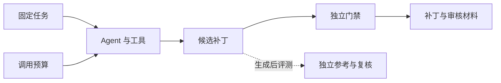

# Coding Agent Harness

基于 Go 的 Coding Agent 运行与验证框架，以代码迁移为验证负载。当前开发重点是**运行时可靠性**与**评测验证**：记录一次运行，解释失败，验证中断恢复，并通过独立对照衡量效果与成本。

项目处于开发中。当前阶段和下一步见[开发入口](docs/README.md)，目标、范围及验收标准见[需求](docs/REQUIREMENTS.md)。

## 当前能力

已有单机多仓库批次、预算预留与结算、Docker 执行、独立质量门禁、运行记录审计，以及受控整代重跑。rpcx v1 → v2 迁移提供固定开发任务和独立参考。

统一 trace、完整 Run 回放、step 级恢复和三组重复对照尚未验收。现有结果来自小规模已见开发样本，不能证明稳定收益或未见仓库泛化。



执行完成与候选质量分别记录：`Completed` 表示交付流程完成；`ReadyForReview`、`NeedsAttention`、`Rejected` 分别表示证据充分、仍需确认和已有违规证据。交付范围是补丁与审核材料。

## 快速开始

需要本机 Go 与 Git。根模块声明 Go 1.23；固定场景此前使用 Go 1.26.5 验证。

```sh
./scripts/verify-rpcx-t1-t2.sh
```

该命令运行五个固定候选的门禁检查，无需模型密钥或 Docker。预期全部显示 `expected=true`：正确候选为 `ReadyForReview`，四个反例为 `Rejected`。产物写入新建的 `runs/` 子目录；它不运行自主 Agent。

其他日常操作见[命令](docs/command.md)。

## 代码入口

| 位置 | 职责 |
| --- | --- |
| `cmd/harness` | 单任务、batch、audit 命令组装 |
| `internal/agent`、`repotools`、`deepseek` | Agent 循环、受限仓库工具、模型适配 |
| `internal/campaign`、`budget`、`execution` | 调度、预算、执行与资源归属 |
| `internal/audit`、`recovery` | 审计与受控恢复 |
| `scenarios/rpcx` | 迁移负载、领域门禁与独立评测 |

历史实验和设计按需查阅，入口见[开发文档](docs/README.md#参考材料)。
