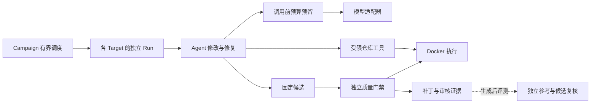

# Multi-Repo Coding Agent Harness

基于 Go 的多仓库 Coding Agent 运行与验证框架。以公共 RPC SDK `rpcx` v1 → v2 的不兼容升级为场景，让 Agent 按迁移规范修改代码，由 Harness 管理批量执行、预算、验证和审核交付。

**当前可交付有明确支持范围的工程开发版。**已完成四个固定样本的真实模型批次及离线复验；严格未见留出、独立人员验证和任意仓库适用性尚未验收。

## 为什么需要 Harness

SDK 升级会同时改变接口和行为。例如，v2 移除隐式 30 秒超时后，代码可能仍能编译、原测试仍通过，却不再满足迁移要求。多个仓库还有不同封装、构建配置和调用链，迁移可能失败、超时或中断。

本项目把这些工作组织为可追溯的执行流程：Agent 探索和修复代码；运行时限制资源与调用成本；独立门禁依据规范和实际证据判定候选；审核人获得补丁、验证结果及尚未证明的问题。

## 如何运行

一个 Campaign 包含多个固定输入的 Target，每个 Target 有独立 Run、工作区和证据。Run 先检查基线，通过后进入 Agent 循环，提交候选后再执行独立门禁。



几个关键约束：

- **生成与判定分离**：Agent 不能修改可信规范、验收材料或独立参考。
- **预算先预留**：批次和 Target 同时检查调用次数及 Token 额度；用量未知保留整额占用。Token 预算以供应商声明上界为前提，不等于金额账单上限。
- **故障局部化**：单任务失败保留记录并继续其他任务；共享账本或控制记录失效时停止批次。
- **恢复保留历史**：支持声明范围内的中断检查、单代完整重跑、累计预算和精确容器清理。
- **结果有证据边界**：明确违规才拒绝，证明不足保留未知；编译、测试或模型自述不能单独构成放行依据。

## 如何理解结果

执行状态与候选质量分别记录。`Completed` 表示运行交付完成，允许候选被拒绝或需要关注。

| 质量判定 | 含义 |
| --- | --- |
| `ReadyForReview` | 当前规范和支持范围内的必需证据充分，可进入常规审核 |
| `NeedsAttention` | 存在验证缺口或超出当前证明范围，需要重点确认 |
| `Rejected` | 已有证据确认违反必需约束 |

每个 Run 交付 `artifacts/candidate.patch`、`artifacts/report.json`、`artifacts/review.md` 及关联日志；批次提供 `summary.md` 和预算账本。项目以候选补丁和审核材料为边界，不自动合并或部署。

## 已观测的真实结果

[2026-10-22 四任务评测](docs/experiments/2026-10-22-rpcx-fixed-real-model-01.md)采用固定协议，每任务一次尝试，四个 Run 均完成交付：

| 样本 | 原门禁 | 独立评测与复核的主要发现 |
| --- | --- | --- |
| Goddd | `NeedsAttention` | 自动参考通过，额外 mock 行为修改仍缺依据 |
| Translation | `NeedsAttention` | 两配置参考及助手复核支持候选，原结构证明仍有缺口 |
| Workouts | `ReadyForReview` | 自动参考及助手复核通过，本轮唯一有效自动成功 |
| GHCLI | `Rejected` | 自动参考通过，助手确认拒绝依据存在误判 |

有效自动成功 **1/4**，错误放行 **0/1**；120 次生成准入、196 次工具调用、**1,885,967 已知 Token**，未知及在途占用为 0。三个样本为已见开发数据，一个为隔离准备后已校准数据；四个固定样本和一个放行项不足以推断生产概率。

随后已[修正 GHCLI 的误拒分类](docs/worklog/2026-10-22-ghcli-proof-classification.md)：保存候选在新门禁下为 `NeedsAttention`，明确脱离父取消链的负例仍被拒绝。此结果属于事后开发回归，原实验判定和 1/4 指标保持不变。

## 从哪里开始

只有源码时，可先运行固定候选门禁检查。需要本机 Go 与 Git，本轮验证工具链为 Go 1.26.5；模块通过本地 replace 解析，脚本禁用模块网络，不需要 Docker 或模型密钥：

```sh
./scripts/verify-rpcx-t1-t2.sh
```

预期五个用例均显示 `expected=true`：`correct` 为 `ReadyForReview`，其余四个反例为 `Rejected`。新报告写入命令打印的 `runs/rpcx-t1-t2-*/report.json`。这验证固定候选的门禁行为，不运行自主 Agent。

要查看和复验真实批量交付，按[离线演示指南](docs/DEMO.md)使用另行提供的四任务归档：核对摘要、审计原批次、重算指标，再沿 Workouts 和 GHCLI 的证据理解两种结果。所附完整复验二进制适用于 macOS Apple Silicon，需要 Python 3.11+，不需要 Go、Docker、联网或模型密钥。归档与 `runs/` 不随 Git 克隆提供。

## 代码与进一步阅读

| 位置 | 职责 |
| --- | --- |
| [cmd/harness](cmd/harness) | 单任务、批次与审计命令的组装入口；恢复由 Go API 提供 |
| [internal/agent](internal/agent) / [internal/repotools](internal/repotools) / [internal/deepseek](internal/deepseek) | Agent 循环、仓库工具、当前模型适配器 |
| [internal/campaign](internal/campaign) / [internal/budget](internal/budget) / [internal/execution](internal/execution) | 批次调度、预算与执行后端 |
| [internal/audit](internal/audit) / [internal/recovery](internal/recovery) | 只读审计与受控恢复 |
| [scenarios/rpcx](scenarios/rpcx) | SDK 迁移场景、业务门禁、构造任务及独立评测 |

新增仓库需要可信 Profile 和适用的验证材料，不能仅换一个目录就获得支持。当前主要覆盖 Go 的 rpcx T1/T2 和默认超时这一代表性 T3；单机执行，付费恢复、连续多代恢复和更广 SDK 语义仍待扩展。

- [当前交付、版本与剩余工作](docs/DELIVERY.md)
- [演示步骤与预期输出](docs/DEMO.md)
- [项目目标](docs/PROJECT.md)、[里程碑](docs/MILESTONES.md)、[命令参考](docs/command.md)
- [长期技术决策](docs/adr)、[文档索引](docs/README.md)
