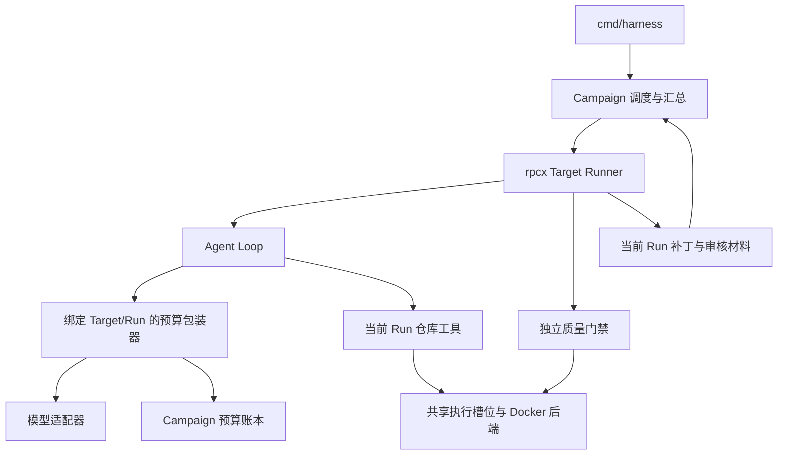

# M3：多仓库批量闭环设计

- 日期：2026-10-19。
- 状态：实现中；M3.1 预算核心与单 Run 接入已在受控模型范围验收，其余单元尚未实现。
- 对应里程碑：[M3](../MILESTONES.md#m3多仓库批量闭环)。
- 代码基线：ac6fe04；前置结论见 [M2 收尾](2026-10-18-m2-evidence-gate.md#25-m2-收尾有限范围验收与-m3-移交)。
- 交付记录：先确定任务、预算、隔离、数据划分和验收契约；第 10 节记录 M3.1 实现。其余接口、目录与 batch 命令仍是拟议设计。

## 1. 本阶段要解决的问题

给定多个仓库的固定版本及迁移要求，Harness 在一个批次内分别准备工作区、运行 Agent、独立验证和交付；并发与总调用消耗有界，单个任务失败不取消无关任务。批次结束时能回答：每个仓库跑到了哪里、有什么补丁、依据是什么、花了多少、哪些结果仍不确定。

当前三个限制决定实现顺序：

- [Runner](../../scenarios/rpcx/runner/run.go)固定使用 demo-orders、两个 SDK 和 internal/pb；T3 还认证固定基线摘要。[门禁](../../scenarios/rpcx/checks/t3_evaluate.go)、测试适配、业务探针和 request_scope 都有场景约束。换一个目录不等于支持另一个仓库。
- [Agent Loop](../../internal/agent/loop.go)只有单 Run 调用/工具次数限制。usage 是调用后事实，不能防止两个 Run 同时花掉最后额度。
- Runner 先生成再进入完整 Evaluate；现有 T3 启动检查认证输入，不能代替各仓库的实际基线构建/测试。M3 要在付费生成前检查基线，并在失败时保留任务记录。

优先级：预算不超承诺边界、结果归属正确、故障局部化，其次是并发吞吐和代码复用。首版仍单机、固定本地输入、Docker 执行仓库命令；不加入自动拉取仓库、PR、分布式队列或自动重试。M4 负责中断恢复、受控重跑及通用审计。

## 2. 任务模型与场景边界

### Campaign、Target、Run 各管什么

| 对象 | 身份与职责 | 不承担的职责 |
| --- | --- | --- |
| Campaign | 一份固定批次计划、共享额度、并发配置、Target 清单与汇总 | 不修改候选质量结论，不把所有任务压成一个成功/失败 |
| Target | 稳定任务 ID；仓库版本/文件摘要、规范、可信任务配置与构建配置、单任务限制 | 不等于一个可变工作目录；不得引用另一个 Target 的候选 |
| Run | Target 的一次实际尝试；唯一 ID、独立工作区、状态、候选和证据 | Completed 只表示交付完成，不等于 ReadyForReview |

同一仓库的不同输入版本或规范是不同任务身份；一个 Target 未来可有多个 Run，M3 每 Target 最多创建一次。重试从冻结基线创建新 Run 的关系字段可以预留，但本阶段不实现恢复/续跑。Target ID 用受限字符并校验唯一性，路径由宿主分配，不直接用用户 ID 拼任意路径。

启动时固定 Campaign 配置及材料摘要；输入仅允许本地无 Git 元数据的快照，沿用文件数量、大小、符号链接和路径重叠约束。外部仓库的获取与依赖准备在运行前完成并记录来源。复制后核对实际快照摘要，再从副本执行，Agent 不接触原始仓库。缺少依赖或不支持的输入应在生成前暴露。

### 为什么不直接给旧 Runner 加一个 for 循环

| 方案 | 得失 | 选择 |
| --- | --- | --- |
| 对旧 ScenarioDir 列表调用 Run | 调度原型最小，但仍只接受固定 demo-orders，容易把复制三份当异构支持 | 只允许作机制对照，不作为 M3 交付 |
| 立即抽通用工作流引擎、验证插件与规则 DSL | 扩展点多，但只有 rpcx 一个迁移领域，尚不知道哪些差异值得抽象 | 不采用 |
| 通用 Campaign 调度＋宿主提供的 Target 执行函数＋显式 rpcx 任务配置 | 批次代码不依赖业务，现有门禁可渐进适配；每个新仓库仍需证明配置与可信检查 | 首版采用，接受场景接入成本 |

拟新增 internal/campaign，只依赖通用记录、agent.Model、execution.Executor 和注入的执行函数，不导入 scenarios/rpcx。scenarios/rpcx/runner 保留准备、迁移和验证业务流程，逐步改为消费宿主认证的任务配置；原单仓库 CLI 保留兼容入口。不为搬目录而一次性重写全部 Runner。

最小调用契约可表达为 `RunTarget(ctx, target, services) (Attempt, error)`：services 提供本次目录、已绑定 Run ID 的受预算控制模型及受限执行器；Attempt 仅包含 Run ID、终态、判定、报告路径/摘要及原因码。执行函数负责发布完整报告后才返回 Completed；Campaign 核验归属和路径，并持久化 Target 结果。具体 Go 类型在第一个实现单元确定，不将完整 rpcx Evaluation 塞进通用调度接口。

可信任务配置包括业务模块与只读 SDK 布局、保护路径、规范 pin、构建配置集合、基线测试身份，以及宿主选择的验证实现/材料摘要。**配置不得由候选修改，不含 expected verdict 或 oracle。** 新仓库的原测试适配、可信行为探针、允许生产改动范围分别维护；复用 quality 聚合和类型身份分析，不直接删除旧基线 pin 或通配忽略 AST 差异。

职责与调用关系如下；Agent 只能触及自己的仓库工具，门禁在提交后独立运行：



每个拟支持仓库先过三种候选：已知正确、明确违规、超出证明范围。缺必要验证时交付 NeedsAttention，不能默认为通过；基线失败或验证设施错误属于执行问题。包含 build tag 的任务必须枚举必需配置，每个配置实际构建和验证，任何必需配置缺证据均不得放行；不以默认配置通过代表整个仓库通过。

## 3. 并发和资源所有权

| 执行方式 | 优势 | 成本与故障边界 | 本次取舍 |
| --- | --- | --- | --- |
| 串行 | 状态最容易观察，作为一致性参照 | 不交付有界并发 | 保留 concurrency=1 对照 |
| 单进程、有界 goroutine 运行 Target | 共享额度可由单一锁管理，复用函数式 Runner | 宿主崩溃会影响整批；不能单独 SIGKILL 某个 goroutine | 首版采用 |
| 每 Run 一个 worker 进程 | 可独立强杀 worker，隔离部分宿主错误 | 需要 IPC、中心预算服务或跨进程事务、worker 生命周期和凭证传递 | 暂缓；出现不能响应取消的宿主组件或要求 worker 崩溃隔离时重评 |

Campaign 按清单顺序接纳最多 N 个 Target，任务从准备到交付/清理均占槽位，完成后接纳下一个。每个 Run 单独 context、工作目录、证据目录和可写缓存；不共享消息切片或候选内容。单 Run 错误只结束该任务，不用“首个 error 取消全批”的组合方式。M3 不以 recover 掩盖任意宿主 panic；进程崩溃属于 M4 恢复边界。

另设 Campaign 级 execution 槽位 K，覆盖基线、Agent go_check、类型加载及独立门禁的每次 Executor.Run。槽位在命令退出且回收完成后释放，等待可取消；没有槽位时不能先创建容器。避免以后验证器内部并发绕过 N。每容器资源限额固定，运行容器总数不超过 K；这限制容器资源分配，不宣称限制宿主 Go 内存、Docker daemon 或全机总内存。SDK/工具材料只读，可写缓存按 Run 隔离。

拟默认 N=2、K=2，仅是开发起点，先用 1/2/3 的确定性对照验证；配置上限和实测机器容量写入实验，不宣称最优。业务失败、构建错误、单 Run 预算耗尽、非法模型回复、所属执行容器被杀是任务级故障。共享账本写入失败、输入注册表损坏等无法维护共同不变量的问题停止接纳新任务，取消在途工作并保留诊断；Docker daemon 故障可能影响所有任务，不承诺共享基础设施故障隔离。

## 4. 批次预算：调用前预留、调用后结算

### 4.1 先说清楚预算单位

批次同时设置请求次数上限和 Token 额度，Target 另有自身次数/Token/时间限制。调用次数是本系统允许的付费尝试数；Token 是输入加输出累计值，包含重复发送的历史与缓存命中输入，缓存字段不重复累加。不将本机工具次数与 API 次数相加，也不把 Token 上限称为货币账单上限。首版不实现按实时价格换算的金额硬限额。

| 方式 | 问题或收益 | 选择 |
| --- | --- | --- |
| 响应回来后检查总 usage | 多个请求可能已经超额 | 不采用为准入 |
| 字符数/经验 tokenizer 估算后预留 | 利用率高，但协议模板、工具 schema 和服务端处理可能未计入 | 可以展示估计，不能作硬上限依据 |
| 每个 Target 启动前预留整个 Run 最坏额度 | 分配确定、无需等待结算 | 40 次全上下文上界会锁住大量闲置额度，不采用首版 |
| 每次调用按经核实的模型上界预留，实际用量结算 | 不需要自己猜精确分词，可复核；预留明显偏大 | 首版采用；上界条件不满足时禁止该付费配置进入批次 |

首版每批一个冻结的模型配置：endpoint、模型标识、文本 Chat Completions、thinking disabled、max_tokens、无服务端工具、无自动重试。Profile 另保存 context 上界 C、输出限制 O、来源与核实时间。保守每次预留 Q=C+O：即便 C 是输入输出合计上限，也接受额外预留 O，避免把不同供应商字段含义直接统一为更紧的上限。输出 O 必须真实编码到请求，C 不能由用户任意填写一个偏小数字。

外部依据：2026-10-19 查询的 [DeepSeek Models API](https://api-docs.deepseek.com/api/list-models/)说明 context_window 包含输入与输出，max_output_tokens 是服务可接受的输出上限；[Chat Completions](https://api-docs.deepseek.com/api/create-chat-completion/)提供 max_tokens 与 usage。这里引用字段契约，不把文档示例数值或当前模型别名写成永久常量。真实实验前需保存匹配 endpoint/model 的能力材料并验证适配器约束；本轮只读公开文档，未请求带鉴权的模型 API。

**保证是有前提的：**服务按声明上界计量、一次 Complete 最多发送一次生成请求、没有额外计费工具。若无法核实上界，不能用估算解锁“严格 Token 预算”运行；先用可控服务验证机制。模型别名变化、供应商额外计费或账单延迟不受本地锁控制。观察到 usage 超过预留必须记录原数并停批，标记上界契约违反，不能截断数字来伪造不变量。

代价可用一个纯算例解释：若 Q=100，批次上限 250，两个请求同时预留后只剩 50；其中一个实际使用 20 并结算，释放 80，才能准入第三个。若该请求断连，则其 100 保留未知占用，不释放。数字不是实际模型预算。过大的 Q 会使低余额仍无法发起小请求；若这一问题阻碍开发实验，再比较经认证的精确计数或更紧的上界，不擅自缩小 Q。

### 4.2 账本与并发不变量

设 S 为可信已知用量，H 为在途预留，U 为已经返回但用量未知的保守占用，B 为上限。Campaign 及每个 Target 同时满足 `S + H + U <= B`；请求次数也同时检查。Q、usage 和累计值用非负 int64，先检查加法溢出；每次请求唯一 call_id 绑定 Campaign/Target/Run、配置与请求摘要。

拟用 internal/budget 的模型包装器实现 agent.Model，持有只读配置及 Target/Run 身份。它在调用实际 Model.Complete 前原子预留并落盘，返回后先结算再把 reply/error 交给 Loop。批量组装只向 Runner 提供这个包装器，不暴露可绕过它的原客户端。预算与 provider 以小接口协作，不修改仓库工具，也不把费用政策写入 Agent 提示。

包装器保存消息/工具的规范化摘要及配置摘要，注明这是模型接口输入身份，不冒称 HTTP 字节摘要；需要确切请求字节时由适配器另行提供脱敏材料。模型配置在批次内不可变。结算使用独立有限收尾 context，不能因原 Run 已取消而直接跳过；usage 只有字段齐全、非负、输入输出合计一致并满足上界时才可信，缺字段不能靠 Go 零值视为零消耗。

采用单一共享池＋Target 上限，不承诺各 Target 平分预算。预留同时检查两级额度；暂时不足且在途结算可能释放额度时按 FIFO 等待，禁止忙轮询，等待计入 Run 时限。已经确定不足时返回带作用域和原因的预算拒绝；不同 Q 时不能由永远不可满足的队首阻塞其余请求。结算只唤醒等待者，仍须重新原子检查。额度充足下的故障隔离与共享额度不足下的调度选择分开验收，不保证低预算下总是同一仓库先完成。

| 事件 | 账目行为 | 执行行为 |
| --- | --- | --- |
| 参数检查失败或等候中取消，尚未预留 | 不记付费调用 | 拒绝/取消该请求 |
| 预留成功并持久化 | 增加 H 和保守调用占用 | 才允许进入真实 Complete |
| 有合法 usage，包括内容协议错误的回复 | H 转 S，释放差额 | reply/error 原样交给 Loop；有成本不等于任务成功 |
| 无 usage、读取失败、超时、断连、HTTP 错误 | H 转 U，整额保留；调用次数仍占用 | 保留原错误；合法回复缺 usage 可继续，但成本未知不记为零 |
| usage 为负、合计不一致、溢出或超出 Q/配置上界 | 不释放预留；保存原始观测，标记预算完整性错误 | 停止批次新增调用并取消任务；不能宣称预算验收通过 |
| 重复结算 | 相同 call_id、相同结果幂等；冲突结算报错 | 不得再次释放或扣除 |
| 结算落盘失败 | 已持久化 H 继续保守占用 | 全批停止新增请求，报告基础设施错误 |

包装器边界无法可靠判断底层 Complete 是否已经发出网络请求。因此预留后即使客户端本地编码失败，也暂按未知占用处理；不增加复杂的传输证明协议来追回这点额度。Complete 必须无隐式重试/重定向重放；允许的 Transport 由宿主控制，不能接入任意会重试的客户端。今后添加重试必须每个尝试重新取得额度。

当前 Loop 在 Complete 前增加 ModelCalls，它包含被包装器拒绝的尝试。实现时明确区分 Loop 尝试数、准入请求数、已知/未知用量；既有字段含义不静默重写。预算拒绝用稳定错误/原因码映射为 limit_reached，不伪装成 provider 故障；批次令牌拒绝发生在 HTTP 前，需要测试服务实际收到的请求数为零。预算提示仍是建议，不能当作持有额度的凭证，也不保证最后剩余额度一定足够提交。

### 4.3 为什么账本先持久化，但恢复放 M4

只用内存锁解决并发，却无法解释进程中断时已经可能消费的请求。首版选择单写者、互斥锁保护的完整 budget.json 快照：候选新状态写临时文件、同步、同目录 rename 并同步目录，成功后才发布内存状态/调用模型；结算同样处理。保存单调 revision 及逐 call 记录，几十到几百次请求的预期规模先接受重写成本。文件系统不支持所需持久化语义或写入结果不确定时立即封闭准入。

相比追加日志，快照不需要本阶段同时实现日志重放、尾部截断和快照合并；相比 SQLite，不新增依赖与迁移机制。代价是写放大和锁持有期间的 I/O；用假持久化故障和实测写入开销验证，调用量明显增加时再比较数据库。一次网络调用不持有账本锁。

M3 拒绝打开已有 Campaign 继续运行，Campaign 目录以独占创建防止两个进程共用账本；崩溃后的 H 不自动释放，不通过重启新账本冒充原批次恢复。预算上限按 Campaign 生效，另起 Campaign 是新的预算授权范围，不是旧任务的免费重试。M4 才实现旧账本读取、未决请求处理及同一 Campaign 的新 Run 重试；M3 的原始记录必须足以表达不确定状态。

## 5. 状态、持久化与结果汇总

拟议产物布局：

```text
runs/campaign-<id>/
  plan.json                 # 固定计划、配置和输入身份，不含密钥
  campaign.json             # 执行状态及汇总是否完整
  budget.json               # 预算快照和逐请求记录
  targets/<id>/target.json  # 当前调度状态与 Run 引用
  targets/<id>/runs/<run>/  # 独立输入、工作区、证据和原 Run 终态
  summary.json              # 逐 Target 结果与用量，不重算门禁
  summary.md                # 面向审核人的入口
```

Campaign 为 Running → Completed / Failed / Cancelled；Completed 表示所有 Target 已有终态且汇总成功，不表示所有迁移成功。Target 为 Pending → Running → Finished，或 Pending → Skipped；Finished 内引用 Run 的 Completed/Failed/Cancelled 及原因。Skipped 仅用于从未启动的任务，注明批次取消、明确预算不足等原因，Run ID 与质量 verdict 均为空。发生局部输入读取或基线失败时，已经启动的 Run 记 Failed，不把它跳过以抬高成功率。

Campaign 先验证清单结构、ID、配置、输出位置及共享模型能力，再创建计划与全部 Pending 记录。各 Target 入槽时先创建 Run 记录，再进行自己的输入读取/基线构建和测试；某 Target 源路径失效不能取消其他有效 Target。基线就红时结束 Run、保存日志，模型调用为零。基线成功后才能生成；独立验证仍检查实际基线/候选绑定，不凭启动时通过跳过必要证据。

发布顺序：输入与阶段 → 候选/验证/审核材料 → Run 终态 → Target 引用 → 批次汇总 → Campaign 终态。Run 材料完整但 Target 或汇总写失败时，保留原 Run，不回写它为失败；Campaign 不能报完成。路径均限制在本批次，摘要对应固定输入和具体 Run；报告明确质量为 null 的执行失败，不能把非空的部分候选视为交付成功。

单 Target 的正常错误保留后继续；Target 自身证据写失败且还能可靠记录失败时属于局部错误。共享 plan/账本/Target 结果无法持久化时属于批次控制失败。关闭时停止新任务，取消活动 context，等待清理后汇总；收尾有独立有限时间，失败需标记待清理资源。Go goroutine 不能强制终止，因此不保证对任意不响应 context 的宿主实现按时退出。

CLI 拟增加 `harness batch --config <plan.json>`，保留旧单仓库参数路径；JSON 严格校验未知字段和路径，首版不引入 YAML 依赖。配置只引用环境变量名/宿主模型配置，不保存密钥。拟定退出码：0 为批次执行和交付完整（允许质量 Rejected/NeedsAttention），1 为执行失败或有未启动任务，2 为配置非法，130 为用户取消；质量计数必须同时输出，不能只看退出码判断可审核补丁数。命令实现并验证前不加入 command.md 的可用命令表。

## 6. L2 数据：先划分，再迁移调试

拟用 4 个不同来源/业务结构的仓库作为首批规划：3 个开发、1 个留出。数量是起点，不代表统计功效。已有 demo-orders 继续用于回归，不作为新增异构证据；纯复制、改名或由参考补丁反向生成的变体仍归构造任务。

开发集合需要覆盖：同步直接封装与不同调用链、存在显式构建配置的仓库、具有不同保护/生成代码布局或测试组织的仓库。先寻找有来源版本、许可及原业务测试的可离线裁剪工程，再将 SDK 边界接入本地 rpcx，记录裁剪和植入改动。仅从零编写的几个小 demo 可验证机制，不能标成半真实 L2。具体仓库尚未选定，不先虚构来源与覆盖成绩。

在接入/调试前固定 split 清单：样本 ID、来源 commit/归档摘要、同源组、开发或留出、基线环境检查流程、材料保管位置及访问记录。同源或近似结构必须同组；先看迁移结果再挑“适合留出”的样本不允许。基线已红等故障变体属于注入集，与正常迁移效果分母分开。

留出需由未参与提示/门禁调优的准备者保管完整输入与 oracle，开发工作区只保留标识、摘要和允许的元数据。准备者可按冻结流程做基线/环境检查，开发者和调优 Agent 不看留出候选、结果及答案。首版不因代码可离线运行就自动创建“全量遍历留出”的测试。

如果只有同一个开发者/助手创建并检查全部样本，就如实记录作者已见，不能称为严格未见留出；必须在 M5 前补充独立准备的样本，或明确降级为固定外部验证集。当前尚无独立准备与保管安排，列为数据准备依赖，不阻止预算和调度机制开发，但不能据此宣布 L2 留出建设完成。此处提出角色边界，不启动子代理或替用户指定人员。

场景的生产门禁配置与独立 oracle 分别编写和保存；不能由 oracle 的通过结果动态选择门禁规则。每个开发仓库在真实生成前固定正确/错误/未知对照与参考标准。如果新仓库普遍因原 AST 模板不适用而全为 NeedsAttention，先回补可信适配或缩小已支持范围，不以批次数量替代迁移有效性。

## 7. 第一次指标与故障验收

先固定分母再运行模型。正常效果集合 N 为协议选定的开发任务尝试数，超时、预算耗尽、生成失败仍在 N 内；配置拒绝和专门故障注入另表记录。报告原始计数、每次尝试、数据/代码/模型/预算身份，不以最佳 Run 替代全部结果。

- 有效自动成功率：原 Run Completed 且 ReadyForReview、独立参考及人工规则复核均通过的数量 / N。
- 错误放行率：被 ReadyForReview 放行且独立复核确认错误的数量 / 全部放行数；放行数为零时无定义。复核不完整时只报告已知错误数 k、未知数 u 和区间 [k/A, (k+u)/A]（A 为全部放行数），不报一个完整比率；同时可列“错误候选中被放行的比例”，但使用不同名称与分母。
- 需人工确认率：NeedsAttention / N，并另列其占已交付候选比例、缺口类型；不把它等同人工耗时。
- 成本：实际已知输入/输出、未知占用、准入/拒绝次数、墙钟、工具/验证耗时；每个 Run 和批次分别列出。人工审核记录开始/结束、实际活动耗时与处置意见；无人计时时标未知。
- 失败原因：配置/基线、调用预算、Token 预算、API/协议、执行设施、验证、发布等；质量 Rejected 与执行 Failed 分列。小样本只说明开发观察，不外推生产概率。

| 验收主题 | 注入或对照 | 必须断言 |
| --- | --- | --- |
| 两级预算与并发抢额度 | 多请求同时争抢仅够一次的额度；同时触及 Target/批次上限 | 最多一个准入，服务收到次数符合记录，无负数/溢出 |
| 结算与未知费用 | 缺 usage、断连、超时、非法 usage、重复/冲突结算 | 未知不释放；合法差额只释放一次；超上界停批且保留实际值 |
| 持久化先于付费调用 | 预留写失败、rename/sync 结果不确定、结算写失败 | 前者零请求；后者旧 H 保留并停止新请求 |
| 基线与任务故障隔离 | 基线已红、单 Run 额度耗尽、非法模型输出；其余固定候选且资源预算充足 | 故障 Target 记录准确，其余 verdict、规范/输入绑定、关键证据与单独执行一致 |
| 真实进程故障 | 杀指定 Run 正在运行的 Docker 执行容器 | 该命令失败可定位且无假通过，其他任务保持结果，资源回收；不称为 worker/Harness 强杀 |
| 并发边界 | N/K 分别为 1/2/3，无故障及故障对照 | 活跃 Target≤N、执行命令≤K；等待可取消，无共享可写目录 |
| 共享预算不足 | 在途预留造成暂时不足、结算后唤醒、永久不足、等待取消 | 不超额，不忙等；Skipped/运行中 limit_reached 原因正确，不要求与充足预算的结果相同 |
| 交付完整性 | 报告成功但 Run 终态失败、Target/summary 落盘失败 | 不误报批次完成，已完成其他 Run 的文件摘要不变 |
| 异构支持 | 每个开发仓库的正确/错误/未知对照，所有必需构建配置 | 正例确可放行，违规/缺口有条款；M1/M2 原用例不退化 |
| 评测隔离 | 核对 split、工具可见根与所有实验输入 | oracle/expected 不进入 Agent/门禁；留出不进入开发执行 |

一致性比较排除时间戳、目录 ID、耗时等元数据；每个 Target 使用独立确定性模型脚本，不能用共享响应队列让调度改变候选。真实模型只用于效果观察，不用其随机轨迹断言调度正确。强杀整个 Harness、预算在途恢复和遗留资源审计按 M4 单列，M3 不宣称已经覆盖。

## 8. 实现顺序与停止条件

| 单元 | 工作与可审查交付 | 进入下一单元的条件 |
| --- | --- | --- |
| M3.1：预算核心与模型接入（受控模型已验收） | internal/budget、两级额度、持久化快照、受控模型包装及原因码；先接单 Run | 竞争、未知 usage、落盘失败、取消、适配器单请求约束对照通过；真实付费能力配置的上界依据另行核实 |
| M3.2：任务契约与场景适配 | Campaign/Target/Run 数据结构；现有 rpcx 任务通过显式配置运行；生成前基线验证 | 单 Target 回归、未知配置拒绝、基线红零模型调用；不复制三份 demo 冒充多仓库 |
| M3.3：有界调度与汇总 | 受预算包装器驱动的批次、双槽位、隔离目录、混合结果汇总 | 串行/并行机制对照、故障注入与发布故障全部通过；没有通过预算门之前不启用付费并发 |
| M3.4：L2 接入与开发评测 | 正式划分、来源/环境、3 个开发仓库及独立参考、保管留出；固定模型实验协议 | 异构正反例、原 L1 回归、可复现基线通过，再按协议执行开发实验并报告所有结果 |

L2 来源摸底和准备者安排可与 M3.1—M3.3 并行推进，但划分必须先于迁移调试；不能直到 M3.4 实验结束再划分。每单元按一个可验收工作提交，不按文件或微小函数拆提交。

若预算账本正确但只能依赖未经证明的 Q，继续离线机制验证，付费批次保持不可用；若故障影响了其他固定候选，先停并发定位；若真实开发集没有任何有效放行，不把“错误放行率不可计算”解释为高可信，回看场景支持边界和模型行为。需要扩展 helper 时先固定正反例并评估成本，不在留出数据上调试。

## 9. 本轮设计检查与后续决策

本轮读取 Runner、CLI、Agent Loop、DeepSeek 协议/客户端、执行后端、T3 门禁及既有 ADR，确认上述差距来自实际代码。只查询公开模型字段说明，未读取 .env 或发起模型生成；没有新增可运行命令、数据集或运行机制，所有验收表都是计划。

预算前置预留及未知消耗保留属于需要长期记住的选择，另记 [ADR-006 草案](../adr/006-campaign-budget-reservations.md)；设计时状态为 Proposed，待 M3.1 验证后转 Accepted。单进程调度、账本存储和场景接口仍在本 worklog 保留取舍，不为尚未验证的每个选择新建 ADR。

设计时计划先实现 M3.1：完成可控服务下的预算最小闭环，再接现有单 Run，证明每次调用确实经过预留和结算。M3 总体验收仍需完成异构批次和开发评测。

本轮文档校验：五份变更文档中的 72 个本地链接目标、新 ADR 指向设计的锚点和代码围栏完整性通过，git diff --check 通过。未运行 Go 测试、Docker 故障注入或真实模型实验；这些仍属于后续实现验收。

## 10. M3.1：预算核心与已有单 Run 接入

- 日期：2026-10-19；实现基于 248e550，验证结果在下方补录。
- 本单元范围：两级额度、模型包装器、持久化与等待、适配器配置约束、已有 Runner 的可选接入。没有实现 Campaign 调度、batch CLI、异构仓库接入或恢复。

### 实现选择与契约落实

新增 internal/budget：Limits/Profile 描述宿主核实的配置；Ledger 保存批次及已注册 Target，NewModel 在实际 Run ID 已知后绑定。一次 Target 在本版本只绑定一个 Run。ProfiledModel 是唯一新增模型能力接口，原 agent.Model 不扩大；DeepSeek 显式实现该接口，未配置 BudgetProfile 时返回未核实错误。

预算模式同时约束调用次数和 Token，两级原子检查；每次预留 C+O。暂时不足等待结算，永久不足持久化带作用域/资源类型的 Rejection 后返回 Denied。FIFO 只在可满足的请求中排序，未满足自身额度的等待者不阻塞其他 Target。等待可由 context 取消，取消等待不伪造成一次付费调用。

账本将 reserved、settled、unknown、invalid 分开保存。合法完整 usage 按实结算，即使回复协议错误；缺 usage 或请求错误保守占用整笔额度；非法 usage 原值保留、额度不释放、共同故障信号取消其他在途模型。相同结算幂等、冲突结算停准入。未知供应商错误正文不进入账本，避免费用记录携带凭证或任务正文。输入摘要只表示消息/工具 JSON，不假装是 HTTP 字节摘要。

存储采用新的独占 budget 目录，文件为 budget/budget.json；因此后续 Campaign 布局相较第 5 节的根 budget.json 多一层目录。这样无需另加锁文件，也不会让两个 Create 共享已有账本；调用方先创建父目录。初始化同步父目录，快照采用临时文件→文件同步→rename→目录同步，返回成功后才更新内存。失败或结果不确定会封闭准入；在途结算失败时，旧 H 仍保留。

落地时没有创建一个可遗留的后台写入 goroutine 来提供表面上的超时：结算与原 Run 的取消独立，直接同步写入；Go 文件 I/O 不能由 context 强制中止。第 4.2 节的独立有限收尾 context 因此收窄为“不因父取消跳过结算”，不承诺底层文件系统阻塞时的硬时间上限。若实际 I/O 阻塞成为问题，在执行/恢复边界重新权衡，而不是释放未结算额度。

DeepSeek Config.BudgetProfile 复制宿主材料并校验 provider/endpoint/model/max_tokens 与实际请求一致；固定现有 thinking disabled、非流式、无自动重试与拒绝重定向。预算模式只允许标准 HTTP Transport，避免直接接受会隐式重试的自定义 RoundTripper。能力来源摘要与核实时间只认证宿主所提供材料的身份，本包不证明真实服务遵守该材料。没有新增任意用户填写 C 即可开启付费预算的 CLI 参数，也没有查询真实 API 或使用凭证。

适配器现在区分 usage 必需字段缺失与合法的 0：缺少 prompt/completion/total 任一字段，整份用量记未知。原协议错误中的完整 usage 继续返回，不因错误丢弃成本。可解码但数值非法的 usage 触发共同故障；包括字段类型或超出 int64 在内的 JSON 解码失败无法形成可用用量，整笔记未知并保留该 Run 的协议错误，不伪造原始数值或释放额度。

Runner.Config.Budget 可接收 Ledger 和 Target ID；生成前用本次真实 Run ID 包装模型，核对模型名，并保存预算 Reference 到 inputs/task.json 与 artifacts/report.json；审核材料显示同一引用。账本不挂入 Agent 可见根目录。ModelCalls 保留 Complete 尝试数，准入数由账本另行记录；新增 agent.ErrModelBudget 将未获准入分类为 limit_reached，Run 失败且无最终质量 verdict。旧无预算入口仍可用，不声称因此已经获得批次总额控制。

### 验证记录

首轮 runs/m3-1-focused-first.jsonl 中预算核心和 Agent 通过，适配器因沙箱禁止 localhost 监听而 panic；同轮 Runner 的既有与新增联调全部通过。该轮整体失败保留，没有将环境错误算为验证成功。随后在允许 localhost 的环境运行预算/Agent/适配器竞态检测；只使用进程内替身和本机模拟 HTTP，未调用真实模型。

新增机制对照覆盖：两级次数/Token 上限、20 个并发请求争抢最后一次调用、暂时额度不足唤醒、永久不足、FIFO 与取消、未知占用、负数/合计不一致/输入输出越界/溢出/缓存计数异常、重复和冲突结算、绑定身份及已有目录拒绝、快照副本、共享故障取消在途请求。存储注入包括预留失败、实际已写入后返回不确定错误、结算失败；都不能使额度再次可用。模型包装器对照确认失败预留/拒绝不执行底层模型，父取消仍记录未知消耗。

适配器通过 localhost 服务对照实际 max_tokens/模型/模式，并在服务收到请求时读取已落盘预留；涵盖完整/缺字段 usage、协议错误、JSON 错误、HTTP 错误、非法用量、重定向不重放、模型配置不符、未核实配置及自定义传输拒绝。服务不是供应商真实端点，这些结果不验证真实 C/O 上界。

Runner 新增两组对照：一组真实调用受控模型、运行原独立门禁并完整交付 Rejected 候选，账本绑定本次 Run 且已知消耗 20；另一组在首次调用前因批次 Token 不足拒绝，模型调用为 0，Run 为 Failed / limit_reached，无质量 verdict，报告仍能定位账本及拒绝原因。这验证接入和执行/质量区分，不是一次真实模型迁移效果。


### 最终验收与下一步

| 验证 | 实际结果 | 证据 |
| --- | --- | --- |
| 预算、Agent、适配器最终竞态检测 | 3 个包、122 项测试及子测试通过，无竞态报告 | runs/m3-1-core-race-final.jsonl |
| 项目代码目录回归，包级并发 1 | 16 个有测试的包、556 项测试及子测试通过，退出 0；包含原 M1/M2 Runner 对照及新增预算接入 | runs/m3-1-project-tests.jsonl |
| 改动包静态检查 | budget/agent/deepseek/runner 的 go vet 通过 | 本轮命令记录 |

完整项目回归启动后新增了一项 Profile 副本/自定义传输机制测试，已包含于最终竞态检测；没有用两轮重复测试计数相加夸大覆盖。首轮 localhost 权限失败记录保留。未重跑完整 L1 正式矩阵或真实 Docker，不将常规跳过项算为执行；本轮预算控制位于宿主模型调用边界，执行后端和质量规则未修改。

M3.1 的受控机制与单 Run 接入已验收，ADR-006 转 Accepted；不是批次调度或真实供应商费用上限验收。真实能力材料和独立留出仍未准备，本轮没有真实模型调用。下一步进入 M3.2：任务契约与显式场景配置、生成前基线构建/测试；M3.3 再接有界调度与汇总。预算模块说明及测试入口已补入文档。

本轮 93 个本地文档链接目标及 4 个新增锚点校验通过，Go 格式、冻结数据改动边界和 git diff --check 通过；源码/测试及结果摘要保存在 runs/m3-1-summary.json。运行产物不入 Git。
