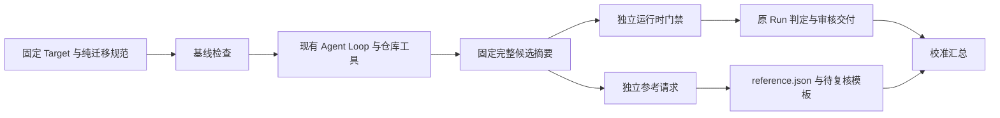

# 隔离应用样本接入 Harness 的设计

- 日期：2026-10-21。
- 状态：设计完成，尚未实现或注册新 Profile/参考入口。
- 实现基线：08ccb305c374e9bb05738bd8568c053f0de6341b；启动时工作区干净。
- 对应里程碑：[M5 准备](../MILESTONES.md#m5独立评测与整体验收)。
- 前置：[应用准入](../../scenarios/rpcx/l2/agent-application-admission-v0.1.0.json)与[行为参考校准](2026-10-21-isolated-application-reference.md)完成。当前完整样本/答案仅由隔离侧保管，主调优流程只收元数据。

## 1. 本项交付与范围

目标是在现有 Harness 链路中支持一个固定应用切片：认证输入、模型前基线检查、受控工具生成、独立运行时门禁、补丁交付，再对同一候选执行独立参考。接入首轮只用受控模型和手工对照作 development_calibration，不运行真实模型、不开放 heldout、不冻结或执行 M5。

本轮交付的是可直接实现的接入方案和可测验收条件。新数据、迁移规范、门禁和参考适配尚待后续实现；已有私有参考脚本不能仅通过改文件名或增加命令就冒充现有 API 的实现。

## 2. 实际差距与依据

主流程读取了 Runner Profile/准备/生成/验证、任务快照、L2 材料与解包后端、参考 Request/Report/Assess、纳入与轮次代码。另由原隔离参考作者只读摸底，返回 `runs/m5-application-integration-design-01/public/capabilities.json`，SHA-256 为 5902c220926c542f4988eeb3cbb0bef574a859666a059ff6862346fac40d3283。它没有修改旧产物、生成归档或运行代码/容器/网络；主流程未读取 private。以下体积为实际文件元数据，尚非新发布归档的执行验收。

| 现状 | 接入影响 |
| --- | --- |
| 旧 B 共 73 文件、376618 字节，含嵌套 v1 SDK；业务模块的 replace 依赖该布局 | 需要发布业务模块与两个只读 SDK 分开的新布局，并记录旧 B→新发布的映射 |
| 旧整体摘要采用相对路径/NUL/文件摘要拼接；task.Snapshot 与 gate.TreeHash 使用文件摘要映射的 Go JSON 再取摘要 | 旧 1be48a… 不能直接填进 Profile.RepositorySHA256；新业务、SDK、布局必须按实际宿主算法重新认证，旧摘要保留作来源身份 |
| 旧 B 有一个准备期新增业务探针；手工参考候选是生产快照，原测试由可信副本补入 | 旧校准候选不是完整 Agent 工作区；需重新发布包含原测试的任务基线与对照，不能把剥离测试的生产副本当作完整候选 |
| 参考可接候选路径并计算摘要，但未校验调用方提供的候选摘要，也未支持完整 Target/Run/规范/后端请求，未输出 evaluation.Report | 需要单候选宿主适配和报告转换，固定矩阵编排只能留在校准驱动中 |
| 私有参考规范含验收/探针规划，尚无纯生成规范 | 必须另写 Agent 可见迁移规范，不能复制参考规范到 spec 可见根 |
| 保留缓存共 6977 文件、106472966 字节（约 101.5 MiB）；最大文件 9236390 字节（约 8.81 MiB）；不含下载缓存的已展开内容也有约 79.8 MiB | 超过现有解包 32 MiB 总量/8 MiB 单文件限制，不能直接复用旧限制或放进 16 MiB 业务快照 |
| 审计 View 单文件最多 16 MiB、累计读取最多 512 MiB；轮次读取文件也限 16 MiB，普通工具材料树仍限 1 MiB 单文件/16 MiB 总量 | 大依赖归档不能作为单个普通证据文件或塞入 materials/tools；需专用有界表示与审计适配 |
| 现有 Docker Executor 使用 UID/GID 65534、CGO_ENABLED=0、只读输入与禁网环境；每条命令创建独立容器，启动基线每命令限 30 秒 | 新发布须验证权限、冷编译和工具链条件，不能沿用旧脚本共享容器缓存的成绩 |
| 当前 Runner、PublishedIdentity、Assess、轮次模块映射均显式列出已有场景；schema 2 协议只支持 development 和三个旧 Profile | Profile、材料后端、门禁、参考、审计/汇总须明确接线；新增单仓库支持不自动获得正式纳入资格 |

只去掉未使用模块是否能降到 32 MiB，目前没有证据；新总归档尚不存在，压缩后字节数保持未知。不能把现有 85 个模块压缩包的 22554301 字节误称为完整依赖发布大小。

## 3. 方案选择

优先保持旧结果可追溯、生成与参考可见范围分离、复用已验收执行/预算机制，其次才是减少本次接线代码。采用现有静态注册模型，不引入通用插件、规则 DSL 或任意脚本执行入口。

| 路线 | 具体得失 | 本次选择 |
| --- | --- | --- |
| 直接包装旧 runs 脚本和缓存路径 | 接入少，但绑定旧目录/自定义摘要/固定矩阵，缺完整请求与标准报告；离开工作区不可复现 | 不采用 |
| 新静态发布＋显式场景适配 | 延续现有五个 Runner Profile 与三个参考的信任方式，能够复用 execution、quality、analysis/testintegrity；需一次正式布局、身份和报告适配 | 采用，接受有限场景接线成本 |
| 现在抽通用材料/验证插件引擎 | 可以动态加载更多场景，但会增加可执行配置、注册/版本和权限设计，当前还只有一个新增来源 | 暂缓；多个新增场景反复出现相同适配成本时再比较 |

依赖分发另作明确取舍：优先把现有有校验和的保留依赖整理为宿主专用发布。先不裁剪第三方源码/测试来强行适配旧 32 MiB，也不引入新的专用 Docker 镜像；前者需要重新证明闭包，后者增加镜像制作/分发和环境身份。旧 runs 的可变缓存不作为运行依赖。

拟只为新发布版本使用可信宿主限额：展开合计 128 MiB、单文件 16 MiB、最多 10000 个文件、压缩归档最多 64 MiB。已测全缓存在展开/单文件/数量上可容纳；64 MiB 是待归档验证的保守准入上界，不是实测压缩量或最优值。业务快照仍沿用 1 MiB 单文件、16 MiB 总量，旧发布仍保持 32 MiB/8 MiB 解包限制。限额由宿主按已认证发布选择，候选、普通任务 JSON 或待解压清单均不能自行放宽。

新依赖分发使用新的宿主清单格式：固定索引绑定模块清单、逻辑 gzip/tar 身份和按序分片，每片最多 8 MiB、最多 8 片，合计仍不超过 64 MiB。索引声明每片名称、长度、摘要与顺序，名称按宿主固定模式校验，不接受任意相对路径；解包按已核对顺序消费逻辑流，不把整份大文件送入审计 ReadFile。相比全局提高审计单文件上限，分片增加一份小索引与格式分支，但能保留现有审计和轮次读取边界，代价有明确收益。

分片与索引归档在独立宿主材料位置，由新门禁/参考登记实际证据摘要；不得放进普通 materials/tools 或业务快照再绕过其限制。Runner 审计新增对应的索引/分片验证，旧单 tar.gz 版本继续原分支。审计累计 512 MiB 上界保持；首轮四组控制分别使用单 Target 的独立 Campaign，逐份审计/汇总后比较，不把复制控制称作异构样本。超过审计累计上限时保留不完整诊断，不能宣称审计完整。

继续保留路径穿越、重复成员、非普通文件、符号链接、尾部数据、声明/实际字节不符与逐文件摘要检查。实际归档超出新上界或只读禁网装配失败时停止发布并重新权衡，不继续提高全局限额。后续若依赖分发成为明显成本，再比较精确闭包裁剪或专用镜像。

## 4. 发布、身份与可见范围

拟新增数据 ID `rpcx-l2-ghcli-v1`、Profile `rpcx-ghcli-t3-v1`、规范 `v0.6.0`、门禁 `rpcx-ghcli-evidence-v1`、参考 `rpcx-l2-reference-ghcli-data-v1`；均为设计名称，当前未注册，没有真实发布摘要。

| 材料 | 生成 Agent | 运行时门禁 | 独立参考 |
| --- | --- | --- | --- |
| 新业务模块、可信原测试、纯迁移规范 | 工作区可写；规范只读；保护路径受限 | 独立副本 | 独立副本，原测试与生产视图分开 |
| 两个 SDK | 工具只读根 | 摘要认证的只读副本 | 摘要认证的只读副本 |
| 宿主依赖发布 | 仅仓库命令的只读 GOMODCACHE，不注册文件工具根 | 独立装配/核对 | 独立装配/核对 |
| 门禁策略、探针、完整性规则 | 不可见 | 可用 | 不读取检查实现或结论 |
| 参考协议、探针和原始参考证据 | 不可见 | 不读取 | 可用 |
| expected、正确补丁与错误对照 | 不可见 | 不读取 | 不作为判断输入；仅外部校准驱动消费 |

新业务输入去除嵌套 SDK 与准备期探针，保留原测试与断言，并把 SDK replace 绑定到显式只读模块。所有变化写旧 B→新发布映射，原业务源码和断言若有非布局变化须单列理由并重新检查适用性。准备期探针、完整 U 和旧证据保留在来源/准备材料，不移入 Agent 根。原 73 文件整体身份、旧手工候选与历史成绩不重算、不覆盖。

使用现有静态发布/冻结清单及受限解包方式；运行输入与宿主依赖、门禁材料、参考材料、校准对照分别存放。仅将必要宿主材料按现有模式嵌入或装配，不能把完整发布根当作 ModuleBackend 挂载根。spec 工具根只含纯迁移规范，不能同目录附参考协议。Agent 缓存与参考缓存独立，生成停止前不装配参考探针到其工作区。

新 Profile 的生成和仓库命令只在 Docker 后端验收并要求使用该后端；trusted_local 可以读取宿主其他文件，不能提供这里的隐藏材料可见范围保证。现有 Profile 的可信本地开发入口保持，新 Profile 不新增本地生成开关。参考的本地显式信任路径若后续需要，仅作为另行声明的诊断，不算本轮隔离验收。

纯迁移规范只描述接口、原业务结果/错误、父上下文、逐调用 30 秒上限和响应所有权/释放要求；不含隐藏测试、时间容差、预期表、正确表达式模板或答案。SDK 与原测试自身公开不构成参考答案发布。

隔离接入者可读取新发布的业务、原规范/SDK及公共 Harness 代码，用于宿主配置与门禁实现；不得读取参考、手工候选或 expected。参考适配者可读取已冻结参考/规范和公共报告契约，不读取新门禁实现。门禁在校准侧提供对照前冻结身份，失败若用于改进则新增修订并记录其已见校准属性，不保留“从未看过结果”的说法。

主调优流程仍只收元数据；发布到 Git 不等于主流程已经读取，但不再能把材料称为 OS 私有。后续提交、格式检查、测试日志和归档由隔离角色处理具体文件内容，主流程只接收受限摘要/计数；若实际打开业务路径、源码或答案，先登记暴露及用途调整。过程隔离不证明独立人员或训练数据未见。

## 5. 最小调用契约与改动位置

继续使用 task.Target 与 runner.Config，不增加第二套 Runtime。目标关系是：



运行时拟由 `scenarios/rpcx/ghcli` 提供与现有场景一致的 Evaluate/HostMaterialsSHA256/PrepareBackend，Runner 新增 ProfileGHCLI、TargetFromGHCLI 和明确分派。Evaluate 接受 checks.EvaluationRequest，返回 checks.Evaluation；判定仍由 quality.Decide 依据实际绑定证据产生，不调用离线参考。

门禁至少完成依赖与保护、构建/原测试事件、测试完整性、类型身份驱动的迁移位置检查、有限变更范围和新写的行为检查。可以复用公共类型分析、结构比较和执行设施，不套用 demo-orders/Goddd 的业务模板。源码结构或等价 helper 超出已证明范围记 unknown/NeedsAttention；明确违规有条款与证据才能 Rejected，全部必需条件充分才可 ReadyForReview。不能因为参考通过便升级原门禁，也不能把旧正确补丁作为结构白名单。

独立参考拟增加以下入口，签名复用现有类型，名称为设计：

```go
// 位于 scenarios/rpcx/l2/evaluation 包。
func EvaluateGHCLI(ctx context.Context, req Request) (Report, error)
```

调用方须提供 Target/Run、候选路径及 gate.TreeHash 摘要、规范、后端和新的证据目录；适配器先认证发布、实际候选和路径边界，再执行。Backend 复用 execution.Executor，不能继续在旧脚本内自行创建 Docker 客户端或固定旧 runs 路径，否则会绕过共享执行槽与资源归属。

原型内固定矩阵编排不进入 EvaluateGHCLI。v1 只作为已认证固定基线的内部参考依据，公开候选 API 一律按 v2 迁移要求检查，不接受调用方把候选标成 baseline 来绕过 v2 契约。剥离候选测试只影响参考生产视图，CandidateSHA256 仍绑定原完整候选；另记录 ProductionSHA256 和注入后副本身份。

输出复用 evaluation.Report、六项自动 section（dependencies/protected_paths/build/candidate_tests/behavior/expiry）及三个待复核项目，条款和具体观测另存绑定摘要的材料。结构表达未识别、缺事件或设施错误为 inconclusive；确认违反为 fail；必需长检查未执行不能为 pass。默认时间与真实到期记录进入 evidence，初始/补充历史修订按原身份保留；适配后的新工具和数据发布新版本，不能只改 JSON 头把旧校准日志冒充标准报告。

| 位置 | 必要适配 |
| --- | --- |
| l2/data、baseline/data.go / dataset.go、l2/materials.go / modules.go | 新布局、来源/测试清单、宿主依赖发布与按版本选择的限额；原解包默认限制保持 |
| runner/profile.go、profiles.json、run.go | 新 Profile 及纯规范/业务/SDK/宿主身份；准备后端、门禁分派与原检查点/预算链继续复用 |
| 新 ghcli 场景包 | 独立门禁、范围/测试完整性证据和审核条款；与参考材料隔离 |
| l2/evaluation 的独立场景适配、identity.go、review.go | 完整请求/报告、PublishedIdentity、版本识别及 Assess；不得导入新场景门禁实现 |
| runner/audit* 与 review* | 核对新 Profile、宿主索引/各分片及实际原测试/补丁路径归属，保留现有审计读取上界 |
| l2/round/reference.go、summarize.go | 新参考版本与业务模块映射；只接当前 schema 1 的 development_calibration 对照，保留待复核和材料核对 |

触及共享工具源码会改变工具摘要，即使旧数据字节未变也不能宣称 ToolSHA256 不变。历史报告/归档继续使用自身材料；旧协议若与新 PublishedIdentity 不匹配，应拒绝重新纳入，需新协议，而非回写旧身份。既有只读重算和恢复兼容必须回归。

暂不把新 Profile 加入 schema 2 的正式协议白名单，不开放 heldout，不新增命令。当前 batch/round 的正式纳入路径继续拒绝它；不能仅通过新增 switch 就把 Agent 准备试点改称原人员留出或 M5 已冻结。

## 6. 实现单元与验收

按两个可验收能力实施，不按单文件拆提交：

1. **新发布及禁网基线可用。**发布纯规范、独立业务/SDK、原测试/来源清单和宿主依赖，认证新摘要与旧 B 映射；使用现有 Executor 完成受限分片解包后的只读禁网构建与原测试，核对非 root 权限、CGO=0 和每命令冷缓存条件，保存准确大小/日志/清理。这个单元只发布可准备输入，不注册会运行到缺失门禁的 Profile。若 30 秒冷基线时限不足，保留实际失败，再比较新 Profile 有界命令预算或镜像方案，不能在测试中偷偷共享旧容器缓存。
2. **单仓库 Harness 与独立参考闭环。**实现并冻结门禁/参考适配，注册完整 Profile/参考身份，受控模型经真实仓库工具提交四组完整候选；每组使用单 Target 独立 Campaign，各自产出原 Run、补丁/审核材料和单候选参考，在 schema 1 校准汇总中关联。无真实模型或新付费授权。

| 验收主题 | 需要观察的结果 |
| --- | --- |
| 新旧数据与摘要 | 新布局/Go 摘要实算，完整 B→发布映射可核；原测试断言不变、准备探针明确排除；旧回执/发布不变 |
| 依赖上界 | 新发布真实分片/解包在专属限额内且逐项一致；大于旧 32 MiB 的构造正例只对新策略接受，旧策略仍拒绝；缺片/顺序错/摘要或长度错、越界/路径穿越/重复/链接/尾部异常拒绝且不执行模型 |
| 基线先于生成 | 缺缓存、摘要不符、解包失败或基线红都零模型调用并留下正确失败记录；正常构建/原测试在工具生成之前 |
| Agent 可见范围 | 新 Profile 拒绝 trusted_local 生成；list/read/search 越界均拒绝；用无业务信息的宿主哨兵验证 go_check 容器未挂载门禁/参考/expected/补丁或其父目录；参考编译缓存与 Agent 隔离 |
| 门禁三态 | 先冻结实现，再用正确/三错误及一个不支持的等价表达校准；明确错误有条款，不支持保留 NeedsAttention，正确候选在声明支持范围可 ReadyForReview |
| 候选与参考接口 | 候选摘要/SDK/规范/Target/Run错配、目录重叠或输出已存在均拒绝；v1 候选不能用 baseline 标签绕过；完整候选与生产视图身份分列 |
| 真实行为与执行器 | 新发布/适配上的正确候选重新实际约 30 秒到期，不能沿用旧布局日志；较短父期限、取消、结果/错误、响应释放按契约观察；所有命令经过同一 Executor 和共享槽位 |
| 交付与复核 | 补丁可还原到同一摘要，review.md 可定位依据，参考不改变原 verdict；自动 pass 加未填复核仍 inconclusive，不替用户签署 |
| 校准与既有兼容 | 受控模型记录只作 calibration，成本不冒充供应商消费；旧 M1/M2/三仓回归与审计/轮次重算保持，新分片经过真实审计/轮次消费且不放宽全局读取上界，schema 2/heldout 仍拒绝未准入新任务 |

任何正例只因引用原正确补丁才被接受、反例依靠 expected 才能识别、隐藏材料进入 Agent 根，或超出新限额后只能放宽全局策略时，停止接线并解决具体问题。参考不识别的等价表达先记 inconclusive，不为了校准全绿降低判据。

## 7. 本轮结果与边界

本轮完成公开架构检查、隔离侧只读能力/大小摸底及上述设计，未制作新发布、纯迁移规范、门禁或参考适配，没有修改 Go 源码、执行 Go/Docker 测试或调用模型。所有拟用 ID、入口与限额均尚待实现验收；旧私有参考校准成绩保持，不据设计宣布新样本可被 Harness 执行。

下一工作单元先实际发布和验收新的可准备输入，随后以一次受控闭环接齐 Profile、门禁、独立参考和校准汇总。M5 仍未冻结、未启动；数据用途与人员/Agent 隔离口径须在未来新协议中明确，原分母不改。

本轮核对：公开能力数据与已有参考身份匹配，限额判断基于实际文件元数据；21 份公开架构文件已记录摘要。五份活动文档的 151 个本地链接、24 个锚点及代码围栏、git diff --check 通过。历史回执、运行时源码和冻结数据未变；核对记录在 `runs/m5-application-integration-design-01/public/verification.json`。主流程未读取 private、未制作或解包新归档，未运行 Go/Docker 测试；设计不产生新的执行成绩。
