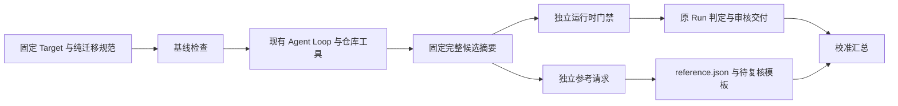

# 隔离应用样本接入 Harness 的设计

- 日期：2026-10-21。
- 状态：两项实现单元均在声明范围验收；第二单元已完成五组实际校准、项目回归与独立核验。M5 未冻结、未启动。
- 实现基线：08ccb305c374e9bb05738bd8568c053f0de6341b；启动时工作区干净。
- 对应里程碑：[M5 准备](../MILESTONES.md#m5独立评测与整体验收)。
- 前置：[应用准入](../../scenarios/rpcx/l2/agent-application-admission-v0.1.0.json)与[行为参考校准](2026-10-21-isolated-application-reference.md)完成。当前完整样本/答案仅由隔离侧保管，主调优流程只收元数据。

## 1. 本项交付与范围

目标是在现有 Harness 链路中支持一个固定应用切片：认证输入、模型前基线检查、受控工具生成、独立运行时门禁、补丁交付，再对同一候选执行独立参考。接入首轮只用受控模型和手工对照作 development_calibration，不运行真实模型、不开放 heldout、不冻结或执行 M5。

第 1—7 节记录设计时的方案与验收条件，第 8 节记录新发布及禁网基线的实施结果。门禁和参考适配仍待后续实现；已有私有参考脚本不能仅通过改文件名或增加命令就冒充现有 API 的实现。

## 2. 实际差距与依据

主流程读取了 Runner Profile/准备/生成/验证、任务快照、L2 材料与解包后端、参考 Request/Report/Assess、纳入与轮次代码。另由原隔离参考作者只读摸底，返回 `runs/m5-application-integration-design-01/public/capabilities.json`，SHA-256 为 5902c220926c542f4988eeb3cbb0bef574a859666a059ff6862346fac40d3283。它没有修改旧产物、生成归档或运行代码/容器/网络；主流程未读取 private。以下体积为实际文件元数据，尚非新发布归档的执行验收。

| 现状 | 接入影响 |
| --- | --- |
| 旧 B 共 73 文件、376618 字节，含嵌套 v1 SDK；业务模块的 replace 依赖该布局 | 需要发布业务模块与两个只读 SDK 分开的新布局，并记录旧 B→新发布的映射 |
| 旧整体摘要采用相对路径/NUL/文件摘要拼接；task.Snapshot 与 gate.TreeHash 使用文件摘要映射的 Go JSON 再取摘要 | 旧 1be48a… 不能直接填进 Profile.RepositorySHA256；新业务、SDK、布局必须按实际宿主算法重新认证，旧摘要保留作来源身份 |
| 旧 B 有一个准备期新增业务探针；手工参考候选是生产快照，原测试由可信副本补入 | 旧校准候选不是完整 Agent 工作区；需重新发布包含原测试的任务基线与对照，不能把剥离测试的生产副本当作完整候选 |
| 参考可接候选路径并计算摘要，但未校验调用方提供的候选摘要，也未支持完整 Target/Run/规范/后端请求，未输出 evaluation.Report | 需要单候选宿主适配和报告转换，固定矩阵编排只能留在校准驱动中 |
| 私有参考规范含验收/探针规划，尚无纯生成规范 | 必须另写 Agent 可见迁移规范，不能复制参考规范到 spec 可见根 |
| 保留缓存共 6977 文件、106472966 字节（约 101.5 MiB）；最大文件 9236390 字节（约 8.81 MiB）；不含下载缓存的已展开内容也有约 79.8 MiB | 超过现有解包 32 MiB 总量/8 MiB 单文件限制，不能直接复用旧限制或放进 16 MiB 业务快照 |
| 审计 View 单文件最多 16 MiB、累计读取最多 512 MiB；轮次读取文件也限 16 MiB，普通工具材料树仍限 1 MiB 单文件/16 MiB 总量 | 大依赖归档不能作为单个普通证据文件或塞入 materials/tools；需专用有界表示与审计适配 |
| 现有 Docker Executor 使用 UID/GID 65534、CGO_ENABLED=0、只读输入与禁网环境；每条命令创建独立容器，启动基线每命令限 30 秒 | 新发布须验证权限、冷编译和工具链条件，不能沿用旧脚本共享容器缓存的成绩 |
| 当前 Runner、PublishedIdentity、Assess、轮次模块映射均显式列出已有场景；schema 2 协议只支持 development 和三个旧 Profile | Profile、材料后端、门禁、参考、审计/汇总须明确接线；新增单仓库支持不自动获得正式纳入资格 |

只去掉未使用模块是否能降到 32 MiB，目前没有证据；新总归档尚不存在，压缩后字节数保持未知。不能把现有 85 个模块压缩包的 22554301 字节误称为完整依赖发布大小。

## 3. 方案选择

优先保持旧结果可追溯、生成与参考可见范围分离、复用已验收执行/预算机制，其次才是减少本次接线代码。采用现有静态注册模型，不引入通用插件、规则 DSL 或任意脚本执行入口。

| 路线 | 具体得失 | 本次选择 |
| --- | --- | --- |
| 直接包装旧 runs 脚本和缓存路径 | 接入少，但绑定旧目录/自定义摘要/固定矩阵，缺完整请求与标准报告；离开工作区不可复现 | 不采用 |
| 新静态发布＋显式场景适配 | 延续现有五个 Runner Profile 与三个参考的信任方式，能够复用 execution、quality、analysis/testintegrity；需一次正式布局、身份和报告适配 | 采用，接受有限场景接线成本 |
| 现在抽通用材料/验证插件引擎 | 可以动态加载更多场景，但会增加可执行配置、注册/版本和权限设计，当前还只有一个新增来源 | 暂缓；多个新增场景反复出现相同适配成本时再比较 |

依赖分发另作明确取舍：优先把现有有校验和的保留依赖整理为宿主专用发布。先不裁剪第三方源码/测试来强行适配旧 32 MiB，也不引入新的专用 Docker 镜像；前者需要重新证明闭包，后者增加镜像制作/分发和环境身份。旧 runs 的可变缓存不作为运行依赖。

拟只为新发布版本使用可信宿主限额：展开合计 128 MiB、单文件 16 MiB、最多 10000 个文件、压缩归档最多 64 MiB。已测全缓存在展开/单文件/数量上可容纳；64 MiB 是待归档验证的保守准入上界，不是实测压缩量或最优值。业务快照仍沿用 1 MiB 单文件、16 MiB 总量，旧发布仍保持 32 MiB/8 MiB 解包限制。限额由宿主按已认证发布选择，候选、普通任务 JSON 或待解压清单均不能自行放宽。

新依赖分发使用新的宿主清单格式：固定索引绑定模块清单、逻辑 gzip/tar 身份和按序分片，每片最多 8 MiB、最多 8 片，合计仍不超过 64 MiB。索引声明每片名称、长度、摘要与顺序，名称按宿主固定模式校验，不接受任意相对路径；解包按已核对顺序消费逻辑流，不把整份大文件送入审计 ReadFile。相比全局提高审计单文件上限，分片增加一份小索引与格式分支，但能保留现有审计和轮次读取边界，代价有明确收益。

分片与索引归档在独立宿主材料位置，由新门禁/参考登记实际证据摘要；不得放进普通 materials/tools 或业务快照再绕过其限制。Runner 审计新增对应的索引/分片验证，旧单 tar.gz 版本继续原分支。审计累计 512 MiB 上界保持；首轮四组控制分别使用单 Target 的独立 Campaign，逐份审计/汇总后比较，不把复制控制称作异构样本。超过审计累计上限时保留不完整诊断，不能宣称审计完整。

继续保留路径穿越、重复成员、非普通文件、符号链接、尾部数据、声明/实际字节不符与逐文件摘要检查。实际归档超出新上界或只读禁网装配失败时停止发布并重新权衡，不继续提高全局限额。后续若依赖分发成为明显成本，再比较精确闭包裁剪或专用镜像。

## 4. 发布、身份与可见范围

设计时拟新增数据 ID `rpcx-l2-ghcli-v1`、Profile `rpcx-ghcli-t3-v1`、规范 `v0.6.0`、门禁 `rpcx-ghcli-evidence-v1`、参考 `rpcx-l2-reference-ghcli-data-v1`；设计时均未注册。第 8 节只落实数据/规范发布，Profile、门禁及参考 ID 仍待实现。

| 材料 | 生成 Agent | 运行时门禁 | 独立参考 |
| --- | --- | --- | --- |
| 新业务模块、可信原测试、纯迁移规范 | 工作区可写；规范只读；保护路径受限 | 独立副本 | 独立副本，原测试与生产视图分开 |
| 两个 SDK | 工具只读根 | 摘要认证的只读副本 | 摘要认证的只读副本 |
| 宿主依赖发布 | 仅仓库命令的只读 GOMODCACHE，不注册文件工具根 | 独立装配/核对 | 独立装配/核对 |
| 门禁策略、探针、完整性规则 | 不可见 | 可用 | 不读取检查实现或结论 |
| 参考协议、探针和原始参考证据 | 不可见 | 不读取 | 可用 |
| expected、正确补丁与错误对照 | 不可见 | 不读取 | 不作为判断输入；仅外部校准驱动消费 |

新业务输入去除嵌套 SDK 与准备期探针，保留原测试与断言，并把 SDK replace 绑定到显式只读模块。所有变化写旧 B→新发布映射，原业务源码和断言若有非布局变化须单列理由并重新检查适用性。准备期探针、完整 U 和旧证据保留在来源/准备材料，不移入 Agent 根。原 73 文件整体身份、旧手工候选与历史成绩不重算、不覆盖。

使用现有静态发布/冻结清单及受限解包方式；运行输入与宿主依赖、门禁材料、参考材料、校准对照分别存放。仅将必要宿主材料按现有模式嵌入或装配，不能把完整发布根当作 ModuleBackend 挂载根。spec 工具根只含纯迁移规范，不能同目录附参考协议。Agent 缓存与参考缓存独立，生成停止前不装配参考探针到其工作区。

新 Profile 的生成和仓库命令只在 Docker 后端验收并要求使用该后端；trusted_local 可以读取宿主其他文件，不能提供这里的隐藏材料可见范围保证。现有 Profile 的可信本地开发入口保持，新 Profile 不新增本地生成开关。参考的本地显式信任路径若后续需要，仅作为另行声明的诊断，不算本轮隔离验收。

纯迁移规范只描述接口、原业务结果/错误、父上下文、逐调用 30 秒上限和响应所有权/释放要求；不含隐藏测试、时间容差、预期表、正确表达式模板或答案。SDK 与原测试自身公开不构成参考答案发布。

隔离接入者可读取新发布的业务、原规范/SDK及公共 Harness 代码，用于宿主配置与门禁实现；不得读取参考、手工候选或 expected。参考适配者可读取已冻结参考/规范和公共报告契约，不读取新门禁实现。门禁在校准侧提供对照前冻结身份，失败若用于改进则新增修订并记录其已见校准属性，不保留“从未看过结果”的说法。

主调优流程仍只收元数据；发布到 Git 不等于主流程已经读取，但不再能把材料称为 OS 私有。后续提交、格式检查、测试日志和归档由隔离角色处理具体文件内容，主流程只接收受限摘要/计数；若实际打开业务路径、源码或答案，先登记暴露及用途调整。过程隔离不证明独立人员或训练数据未见。

## 5. 最小调用契约与改动位置

继续使用 task.Target 与 runner.Config，不增加第二套 Runtime。目标关系是：



运行时拟由 `scenarios/rpcx/ghcli` 提供与现有场景一致的 Evaluate/HostMaterialsSHA256/PrepareBackend，Runner 新增 ProfileGHCLI、TargetFromGHCLI 和明确分派。Evaluate 接受 checks.EvaluationRequest，返回 checks.Evaluation；判定仍由 quality.Decide 依据实际绑定证据产生，不调用离线参考。

门禁至少完成依赖与保护、构建/原测试事件、测试完整性、类型身份驱动的迁移位置检查、有限变更范围和新写的行为检查。可以复用公共类型分析、结构比较和执行设施，不套用 demo-orders/Goddd 的业务模板。源码结构或等价 helper 超出已证明范围记 unknown/NeedsAttention；明确违规有条款与证据才能 Rejected，全部必需条件充分才可 ReadyForReview。不能因为参考通过便升级原门禁，也不能把旧正确补丁作为结构白名单。

独立参考拟增加以下入口，签名复用现有类型，名称为设计：

```go
// 位于 scenarios/rpcx/l2/evaluation 包。
func EvaluateGHCLI(ctx context.Context, req Request) (Report, error)
```

调用方须提供 Target/Run、候选路径及 gate.TreeHash 摘要、规范、后端和新的证据目录；适配器先认证发布、实际候选和路径边界，再执行。Backend 复用 execution.Executor，不能继续在旧脚本内自行创建 Docker 客户端或固定旧 runs 路径，否则会绕过共享执行槽与资源归属。

原型内固定矩阵编排不进入 EvaluateGHCLI。v1 只作为已认证固定基线的内部参考依据，公开候选 API 一律按 v2 迁移要求检查，不接受调用方把候选标成 baseline 来绕过 v2 契约。剥离候选测试只影响参考生产视图，CandidateSHA256 仍绑定原完整候选；另记录 ProductionSHA256 和注入后副本身份。

输出复用 evaluation.Report、六项自动 section（dependencies/protected_paths/build/candidate_tests/behavior/expiry）及三个待复核项目，条款和具体观测另存绑定摘要的材料。结构表达未识别、缺事件或设施错误为 inconclusive；确认违反为 fail；必需长检查未执行不能为 pass。默认时间与真实到期记录进入 evidence，初始/补充历史修订按原身份保留；适配后的新工具和数据发布新版本，不能只改 JSON 头把旧校准日志冒充标准报告。

| 位置 | 必要适配 |
| --- | --- |
| l2/data、baseline/data.go / dataset.go、l2/materials.go / modules.go | 新布局、来源/测试清单、宿主依赖发布与按版本选择的限额；原解包默认限制保持 |
| runner/profile.go、profiles.json、run.go | 新 Profile 及纯规范/业务/SDK/宿主身份；准备后端、门禁分派与原检查点/预算链继续复用 |
| 新 ghcli 场景包 | 独立门禁、范围/测试完整性证据和审核条款；与参考材料隔离 |
| l2/evaluation 的独立场景适配、identity.go、review.go | 完整请求/报告、PublishedIdentity、版本识别及 Assess；不得导入新场景门禁实现 |
| runner/audit* 与 review* | 核对新 Profile、宿主索引/各分片及实际原测试/补丁路径归属，保留现有审计读取上界 |
| l2/round/reference.go、summarize.go | 新参考版本与业务模块映射；只接当前 schema 1 的 development_calibration 对照，保留待复核和材料核对 |

触及共享工具源码会改变工具摘要，即使旧数据字节未变也不能宣称 ToolSHA256 不变。历史报告/归档继续使用自身材料；旧协议若与新 PublishedIdentity 不匹配，应拒绝重新纳入，需新协议，而非回写旧身份。既有只读重算和恢复兼容必须回归。

暂不把新 Profile 加入 schema 2 的正式协议白名单，不开放 heldout，不新增命令。当前 batch/round 的正式纳入路径继续拒绝它；不能仅通过新增 switch 就把 Agent 准备试点改称原人员留出或 M5 已冻结。

## 6. 实现单元与验收

按两个可验收能力实施，不按单文件拆提交：

1. **新发布及禁网基线可用。**发布纯规范、独立业务/SDK、原测试/来源清单和宿主依赖，认证新摘要与旧 B 映射；使用现有 Executor 完成受限分片解包后的只读禁网构建与原测试，核对非 root 权限、CGO=0 和每命令冷缓存条件，保存准确大小/日志/清理。这个单元只发布可准备输入，不注册会运行到缺失门禁的 Profile。若 30 秒冷基线时限不足，保留实际失败，再比较新 Profile 有界命令预算或镜像方案，不能在测试中偷偷共享旧容器缓存。
2. **单仓库 Harness 与独立参考闭环。**实现并冻结门禁/参考适配，注册完整 Profile/参考身份，受控模型经真实仓库工具提交四组完整候选；每组使用单 Target 独立 Campaign，各自产出原 Run、补丁/审核材料和单候选参考，在 schema 1 校准汇总中关联。无真实模型或新付费授权。

| 验收主题 | 需要观察的结果 |
| --- | --- |
| 新旧数据与摘要 | 新布局/Go 摘要实算，完整 B→发布映射可核；原测试断言不变、准备探针明确排除；旧回执/发布不变 |
| 依赖上界 | 新发布真实分片/解包在专属限额内且逐项一致；大于旧 32 MiB 的构造正例只对新策略接受，旧策略仍拒绝；缺片/顺序错/摘要或长度错、越界/路径穿越/重复/链接/尾部异常拒绝且不执行模型 |
| 基线先于生成 | 缺缓存、摘要不符、解包失败或基线红都零模型调用并留下正确失败记录；正常构建/原测试在工具生成之前 |
| Agent 可见范围 | 新 Profile 拒绝 trusted_local 生成；list/read/search 越界均拒绝；用无业务信息的宿主哨兵验证 go_check 容器未挂载门禁/参考/expected/补丁或其父目录；参考编译缓存与 Agent 隔离 |
| 门禁三态 | 先冻结实现，再用正确/三错误及一个不支持的等价表达校准；明确错误有条款，不支持保留 NeedsAttention，正确候选在声明支持范围可 ReadyForReview |
| 候选与参考接口 | 候选摘要/SDK/规范/Target/Run错配、目录重叠或输出已存在均拒绝；v1 候选不能用 baseline 标签绕过；完整候选与生产视图身份分列 |
| 真实行为与执行器 | 新发布/适配上的正确候选重新实际约 30 秒到期，不能沿用旧布局日志；较短父期限、取消、结果/错误、响应释放按契约观察；所有命令经过同一 Executor 和共享槽位 |
| 交付与复核 | 补丁可还原到同一摘要，review.md 可定位依据，参考不改变原 verdict；自动 pass 加未填复核仍 inconclusive，不替用户签署 |
| 校准与既有兼容 | 受控模型记录只作 calibration，成本不冒充供应商消费；旧 M1/M2/三仓回归与审计/轮次重算保持，新分片经过真实审计/轮次消费且不放宽全局读取上界，schema 2/heldout 仍拒绝未准入新任务 |

任何正例只因引用原正确补丁才被接受、反例依靠 expected 才能识别、隐藏材料进入 Agent 根，或超出新限额后只能放宽全局策略时，停止接线并解决具体问题。参考不识别的等价表达先记 inconclusive，不为了校准全绿降低判据。

## 7. 设计单元结果与边界

本轮完成公开架构检查、隔离侧只读能力/大小摸底及上述设计，未制作新发布、纯迁移规范、门禁或参考适配，没有修改 Go 源码、执行 Go/Docker 测试或调用模型。所有拟用 ID、入口与限额均尚待实现验收；旧私有参考校准成绩保持，不据设计宣布新样本可被 Harness 执行。

下一工作单元先实际发布和验收新的可准备输入，随后以一次受控闭环接齐 Profile、门禁、独立参考和校准汇总。M5 仍未冻结、未启动；数据用途与人员/Agent 隔离口径须在未来新协议中明确，原分母不改。

本轮核对：公开能力数据与已有参考身份匹配，限额判断基于实际文件元数据；21 份公开架构文件已记录摘要。五份活动文档的 151 个本地链接、24 个锚点及代码围栏、git diff --check 通过。历史回执、运行时源码和冻结数据未变；核对记录在 `runs/m5-application-integration-design-01/public/verification.json`。主流程未读取 private、未制作或解包新归档，未运行 Go/Docker 测试；设计不产生新的执行成绩。

## 8. 第一实现单元：新发布与禁网基线

- 实现起点：d66d82c6ba3698727d860f1cfcbe07c8a825e9c3，启动时工作区干净。
- 固定任务：`runs/m5-application-release-01/public/assignment.json`，SHA-256 为 18d00be5d48877a4094498051aca98bfbf57c7e5147cf390d4d0c398a585ada5。
- 当前目标：实际发布 rpcx-l2-ghcli-v1、纯迁移规范、业务/SDK 快照、原测试与来源映射、有界依赖分片；扩展既有基线复验入口并通过现有 Executor 验证。尚不注册门禁缺失的 Runner Profile，也不接入独立参考或轮次。

新隔离实现者 `/root/application_release_implementer` 使用 fork_turns=none，仅接收已提交接入设计、原基线/来源和 SDK，可读取公共 Harness 代码；禁止读取已制作的参考规范、参考探针、手工候选或 expected。这使纯迁移规范和宿主材料可实际发布，同时避免接入者以既有正确补丁编写门禁。主流程仍只读通用装配实现和元数据，新业务文件、测试名、来源细节和日志由隔离角色处理。

实现范围限于新数据及 baseline/L2 宿主材料装配，不修改旧数据、Runner Profile、quality 或正式协议。新增分片策略需有实际大于旧上界的正例和恶意输入负例，旧 strict schema/限额继续通过原测试；新基线真实执行应覆盖当前非 root、CGO=0、禁网、只读输入与每命令冷缓存环境。baseline.VerifyVersion 的 90 秒命令预算和未来 Runner 的 30 秒预算分别披露，不以成功的较长预算证明短预算适用。

主动实现预算约 35 分钟；若现有 Executor 约束、冷编译或真实归档超限导致阻塞，保留失败并按本设计的停止条件处理，不使用旧宿主缓存或提高全局限制掩盖问题。

### 实现与实际验证

新发布共 94 文件、42184731 字节；业务与两个 SDK 分开，原测试保留，准备期探针排除，纯迁移规范另写。旧 B 的 73 文件均有映射记录，原测试断言和 SDK 字节未改。依赖保留全部 6977 文件、106472966 展开字节，逻辑压缩流 40368870 字节，分为 5 片；新版本使用专属上界，旧发布仍用原限制。

宿主按固定版本选择策略，先认证冻结清单、模块清单、索引和每片实际长度/摘要，再按序受限解包；检查路径、重复成员、链接、单文件/总量、CRC 和尾部数据。展开缓存采用流式摘要复核，避免把百 MiB 缓存反复装入业务文件映射；只读挂载前后继续检查缓存内容。新增实现被纳入实际工具材料，工具摘要因而变化；未回写旧报告或把旧协议自动重新准入。

| 检查 | 实际结果与范围 |
| --- | --- |
| 现有 Docker Executor 基线 | 固定镜像、非 root、CGO=0、禁网、只读输入、每命令独立冷缓存；9 条命令通过，每条预算 90 秒 |
| 测试事件 | 原业务 11 项（2 顶层、9 子测试），SDK v1/v2 分别 5/10 项完成事件通过；19 个无测试支持包的终态另列，不充当测试数 |
| 30 秒适用性诊断 | 独立冷缓存业务 build/test 分别约 11.951/15.119 秒通过；只说明本机和固定镜像的观测，尚非 Runner 接入验收 |
| 容器回收 | 基线、诊断及环境核对共 12 个容器，逐一按精确 ID 确认不存在 |
| 机制与竞态 | 实际大分片、新旧上界、16 MiB 单文件、索引/归档恶意输入、冻结材料认证、宿主只读装配参数及缓存变更阻断通过；baseline/L2/CLI 三包 race 与 vet 通过 |

首轮 Docker 受沙箱 socket 权限阻断，原失败保留，授权后使用同一禁网 Executor 配置通过。三项恶意归档测试最初因构造器向零长度非普通成员写入正文而失败；修正测试构造器后重新通过，未靠放宽实现处理。原始失败与复现脚本保留在本次 private 证据中，不包装为一次全绿。

独立只读评审 `/root/application_release_reviewer` 不继承主对话，核对最终 9 个变更源码摘要、实际归档的 17 个工具源码、来源映射与原断言、完整依赖和原始命令/事件/回收证据，结论为 accepted_for_published_baseline_scope，未发现阻断问题。该评审没有重跑测试；发布与评审的公开元数据固定在[新回执](../../scenarios/rpcx/l2/agent-application-release-v0.1.0.json)，原准备/参考回执不改。过程隔离限制与第 4 节一致，不称为独立人员评测。

### 兼容回归发现的示例身份失效

项目常规回归首轮覆盖 35 包，其中 deepseek 与 cmd/harness 因沙箱拒绝 localhost 监听失败；其他包完成，Runner 通过。只在权限允许后补跑这两包，随后发现 cmd/harness 的 `TestEnrollmentExampleMatchesCurrentPublications` 确实失败：新工具实现使共享 ToolSHA256 变化，当前使用模板仍声明旧值。

选择更新 [examples 当前纳入模板](../../examples/rpcx-l2-enrollment.json)的三个 tool_sha256，由既有 PublishedIdentity 实算，并同步[批次模板](../../examples/rpcx-l2-batch.json)引用的 enrollment.sha256；不改变其他字段或测试断言。它们是随当前代码使用、无版本号的模板，[命令约定](../command.md)已要求工具变化后发布匹配模板；它们不同于[冻结实验协议](../experiments/l2-dev-eval-v0.1.0/enrollment.json)。保留历史协议的旧身份与拒绝重新纳入行为，也保留本次真实失败；不通过排除新源码、回退工具摘要或放宽身份检查消除失败。模板同步属于本单元共享代码兼容修复，不构成追加实验授权。

最终按唯一包核对常规回归范围：35 包中 28 个测试包通过、7 包无测试文件、0 包未解决失败。三轮退出码依次为 1/1/0；首轮全项目，第二轮仅补 localhost 受影响的两包，第三轮仅补修复后的 cmd/harness，不累加重复包数。默认非 verbose 输出未逐项列出测试 skip，case 跳过数标为未知，不称作零跳过。race 与 vet 的范围为 baseline、L2 和 verify-baseline CLI 三包；这不等于重跑特殊 Docker 矩阵或完整正式评测。各轮日志摘要、模板变更及最终覆盖已附入同一[发布回执](../../scenarios/rpcx/l2/agent-application-release-v0.1.0.json)，原失败日志留在 runs/。

收尾校验包括活动文档链接/锚点、最终源码摘要、7 份历史回执、旧三份数据无差异、新数据 94 文件暂存字节一致及 git diff --check。运行产物不入 Git；将代码、测试、新数据、当前模板和文档作为一个可验收工作单元提交。下一单元仍是受控单仓库 Harness/独立参考闭环，M5 不据此启动。

第一单元只交付可认证、可离线准备的输入与依赖。尚无新 Profile、运行时门禁、标准参考调用、审计/轮次接线或模型生成；下一单元按第 6 节完成受控单仓库闭环。原效果分母、人员留出名额及历史回执保持，M5 未冻结、未启动。

## 9. 第二实现单元：单仓库 Harness 与独立参考闭环

- 实现起点：e7177a0def3c90ec39e12c5ecb27e6c273a4a03b，启动时工作区干净。
- 目标：复用既有 Campaign、Runner、预算与 Executor，接通固定新 Profile、独立运行时门禁、标准单候选参考、审计与 schema 1 校准汇总；只用受控模型，不调用真实供应商。

### 实施分工与冻结顺序

沿用第 4—6 节已确定方案，不新增第二套 Runtime 或任意脚本插件。三位新 Agent 均不继承主调优对话：

| 角色 | 可以读取与负责实现 | 冻结前不得读取 |
| --- | --- | --- |
| application_runtime_author | 新发布业务/SDK/纯规范；独立 ghcli 门禁及 Runner/Profile、输入与审核/审计接线 | 私有参考、参考探针、手工控制、expected |
| application_reference_adapter | 已冻结参考与新发布输入；evaluation 的标准请求、报告、身份与 Assess 接线 | 新运行时门禁/策略/探针，手工控制和 expected |
| application_closure_calibrator | 初期只实现通用 round 映射与协议拒绝测试；两侧实现冻结后才接触控制与具体业务，执行受控闭环并只读评审 | 冻结前的新业务、门禁/参考实现与控制答案 |

三份固定任务分别位于 `runs/m5-application-runtime-01/public/assignment.json`、`runs/m5-application-reference-adapter-01/public/assignment.json`、`runs/m5-application-closure-01/public/assignment.json`，SHA-256 依次为 a8c1f82db234f567c48462ae4d4637b732803e9630a04789b84e6adb65820d18、af0d61960b0f7109706a5d164dba1c748d049cfe50f17ef33243503af5e4c717、0bb425daa70b5759ad23a05ade626e23e2f358c7ffadd62bab7cbcdf647f45f3。主流程维护公开记录与通用接口协调，只接收身份/计数/限制，不读取具体新业务、规范正文或答案。

先实现并冻结门禁/参考各自源码与材料摘要，再开放既有正确/错误控制做新布局校准；不把对照编排塞进 Evaluate。若校准后修正实现，保留失败与旧摘要，明确新修订已受开发校准影响。真实 Executor、补丁重放、材料归属/可见范围、审计与轮次读取验证均须实际执行，未完成项不得记通过。旧协议、旧数据和历史结果不回写，当前可用模板若随工具身份变更则按第 8 节方式同步。

参考 API 继续复用 Request，不另加一套可选身份协议。它可以认证实际候选、固定基线/SDK/规范、输出边界并在报告中绑定 TargetID/RunID；Request 本身没有外部 Run 记录，不能仅凭两个字符串证明调用方选中了正确的外部 Run。跨 Target/Run 的报告错配由轮次汇总核对完整记录与摘要后拒绝。校准使用稳定 TargetID 与每次独立 Run，不通过把所有合法 ID 硬编码为一个值制造表面的身份认证。

### 校准前第二修订与续做

两侧实现均在接触外部控制前完成第二次冻结。运行时自审收紧多重上下文派生的结构归一化，并修正通用 import 分组；参考侧完整回归发现复用了不在基础设施白名单的共享文件筛选，改为独立局部筛选。原冻结、测试构造错误及真实失败分别保留，参考判据/探针数据未因后一次修订变化。这些修订发生在控制开放之前，不冒充首冻结已有结果。

上次执行因账户用量限制中断，未开始完整校准；用户要求继续后，两位作者复核实际文件和原测试终态，未重跑已完成的长矩阵。运行时第二修订的 18 文件集合 SHA-256 为 7a752441211fbd25cd0dc12bbec9259fb3733ac35a2760e34ef9fad383f147ee，三包定向 race、vet、diff-check 通过；参考源码集合 SHA-256 为 9ed85c714620edffc9ec82e92a1bd539f71394b72abbb2d035d636ed828071d9，完整包回归 102 个通过/0 失败/3 跳过（其中适配自身 24 个通过），vet 通过。准确计数均包含各自测试/子测试口径，不相互累加。

校准开放前固定新回执 `runtime-02.json` 与 `adapter-02.json`，SHA-256 分别为 86e7609cdea42bc6f1cc078153b3b9c7fea33eb8a7e585224b5365acf41a9213、5f291453421fbfaafeb9d7632286c55e7ecf35724db521ae553219f20a73fa22；参考数据身份为 3a4891984417a8bb82c1ad2f69693f019b982d1c5c123e1cbd5efd3f28c513a0，参考工具身份为 5bff3c6e719792ea98764ebba58e46b21224805b28f53a0a0c9c0a2fc259fb39。随后才向校准者开放完整材料与控制。通用 round 已通过 12 个校准/拒绝情形及整包测试；实际 Campaign、到期、审计与复核尚待下方记录，不由这些接口测试推定。

另由不继承主对话的 application_integration_reviewer 只读审查两侧冻结实现，待实际执行结束后核对最终证据；它不修改实现、不重跑业务测试。任务为 `runs/m5-application-integration-review-01/public/assignment.json`，SHA-256 为 d02da0793dd34dd89f45c09be26f4b59ca7e525a7e44bbee7a59379896260191。独立上下文与作者分离，仍属同模型家族和共享文件系统的过程隔离。

### 首轮诊断发现与修订依据

外侧校准固定第一版完整输入矩阵 SHA-256 为 e677c2d7fb2636b8454fc216d841d37d46775279086a21eb7d54aa885bbe06b9。只读审查与首个实际 Run 暴露下列问题，不能因接口测试通过便宣布闭环可用：

| 问题与证据 | 本次取舍 |
| --- | --- |
| 参考规范归档层级与 round 的 `materials/spec.md` 契约不同；宿主清单/索引/分片未登记完整证据 | 修订参考产物布局，实际装配后的 7 件材料逐件登记；round 明确检查必要集合及索引顺序、长度、逻辑流与 HostSHA，不仅遍历任意 Artifacts。保持原读取上界，不靠驱动搬文件伪造兼容 |
| 独立复核发现旧参考把命令入口父 value 的传播设为必须，但公开 v0.6.0 只明确既有 HTTP 请求的父 context 义务 | 两侧分别核对纯规范后确认参考过约束。保持已发布规范/基线，保留旧参考数据与条件作诊断，另发 reference-data-v2/report-v2，使自动条件对应公开义务。不以旧“正确”控制标签倒推放宽门禁，也不静默改规范追认额外要求 |
| 实际依赖检查为 unknown，类型/行为被 blocked：公共 ModEntries 不支持发布基线已有 toolchain，expected 解析错误又被忽略 | 选择给共享解析器增加单值 toolchain 键并处理 expected 错误，保留重复/未知语法拒绝、基线与候选值严格比较。局部复制解析器会产生两套语法，另跑两次 Go 命令则增加执行/证据成本；删除或忽略声明会丢失约束，均不采用 |
| 内部 CTX-001 等标识没有对应公开规范的实际位置，审核页只打印 ID | 补宿主规则映射证据，区分 migration_spec 与 host_policy，绑定规范/Profile并给出段落/行号或策略位置。不把内部 ID 称为规范自带条款号，不改冻结规范文本 |

参考兼容修订 03 完整包回归为 103 通过/0 失败/3 跳过，7 件宿主归档均实际登记；但因上述规范范围问题仍保持 calibration_open=false。03 的 `published_identity_unchanged` 标记只可解释为当时规范/参考数据未变，实际 ToolSHA256 已变化，不能表述成整体 PublishedIdentity 未变；后续回执明确分开说明。

第一实际 Campaign 完成并交付 Rejected；12 条命令/12 个精确容器均回收，补丁重放摘要一致，实际审计 pass、完整、0 violation/0 gap。该组含旧参考额外义务导致的超范围变更，且依赖检查阻断行为，故只作契约/设施诊断，不计误拒或正常迁移效果，也没有新 30 秒到期成绩。公开诊断为 `first-runtime-diagnostic.json`，SHA-256 475fdb6cf4abf967e5d8028eb79434bbcae55814aa94b0cd64d2e33072e0f320。原矩阵和失败保留，新规范矩阵必须另固定身份。

校准驱动自身还保留了沙箱 Docker socket 失败、精确缓存挂载识别过严、审计状态字面值断言错误；只修测试观察器/断言，不把它们计为生产代码故障。可见范围验证须有实际存在且摘要已固定的宿主哨兵，再由容器证明不可读；只有若干路径不存在的脚本断言不算完整成绩。只读评审中期为 issues_found/final=false，等待新冻结和实际矩阵后再出最终结论。

### 最终冻结、矩阵修订与中断保留

运行时第三修订在共享 parser/规则映射修复后固定：25 文件集合 SHA-256 为 a609176f395c6a1a8c76ed70f05965e20a7830ad1f24ff705f890a2213319ced，回执 `runtime-03.json` SHA-256 为 904e49693f3b740624fe2b56ef535297618bd691a8c34026bc206f6f08b5bf17。四包定向 unit/race、vet 及 quality/checks/testintegrity 相关三包通过；未据此重复完整 Docker 矩阵。

参考第四修订使用新的不可变 ghcli-data-v2/report-v2，源码集合 SHA-256 为 01550ffc74e3052474eeeec4e0666912503d6753a5267c1fb34b290f7c6ff8c8；ReferenceSHA256 为 feb693bc5eb75aa1876bcf7ddc5bde5b8d28bedca92ff9b32fd0f7dea88acf8f，共享工具稳定后实算 ToolSHA256 为 04348c6a5236ee54f3d9cb2f4082c8b5e8f4b8f58f077a1fb7ada2c0242d1bd1。回执 `adapter-04.json` SHA-256 为 9c41bcb7cd6fdcb481652051140010f99a81fe50789882ca5cd0458c606327a8；完整包回归 104 通过/0 失败/3 跳过（其中适配自身 26 个通过），vet 通过。旧参考数据、源码修订及失败不覆盖。

校准者在这两份最终冻结之前另固定第二版五组完整输入矩阵：SHA-256 为 21b0c2427795bb1cc7e31ebc101f570de67a95bfab0ff645bae383f883b5a0a6。它按已发布 HTTP 请求义务移除第一矩阵额外的命令传播改动，保留三个单错定义与原测试；未以新运行结果挑选候选。包内相对路径清单身份另算，五个候选全树摘要保持；独立可搬移私有包保留完整输入、定义、驱动、离线脚本及所需仓库文件摘要，先认证冻结实现再运行，不访问可变旧缓存。

前两组完整链路已保存：正确候选 ReadyForReview/参考自动 pass，首个单错 Rejected/参考 fail；汇总均完整有效，未填写的复核仍 inconclusive。随后账户用量限制使外侧执行进程消失，第三组停在 CheckingBaseline、4 条命令、零模型调用，4/5 组未启动。恢复核对所属 Docker 标签清单为空，没有遗留容器；保留原未终态目录，不伪改为 Completed。剩余三组在新唯一目录用相同输入摘要继续执行，最终记录须分列中断尝试与受控重跑，不把运行次数掩成只有五个 Run；这些均为机制校准，不进入真实模型效果分母。

续做的第三、第四组均实际完成 Rejected/参考 fail，逐组审计完整通过、round 有效完整，各 23 条命令对应容器逐件确认回收。明确行为失败后的到期项保持未执行/inconclusive，不凭另一组通过填造本组到期成绩。最后一组仍在执行；该时点不据前四组结果声明全部验收。

五组运行时最终均交付 Completed，判定分布为 ReadyForReview 1、Rejected 3、NeedsAttention 1。最后一个等价表达保留门禁证明缺口；独立参考和完整收尾尚待核对，不凭门禁分布反推参考结果或真实自动成功率。

### 最终五组实际链路

第二版矩阵的五个单 Target Campaign 均已完成，实际矩阵回执 `closure-matrix.json` SHA-256 为 f140224ce91aaf2e3ef78cb7f75101c7d5cf54b783a25c3c8e41ff0f8b41f11f。各组使用同一冻结实现，独立规范/候选/Run/工具身份逐项绑定：

| 控制类型 | 原运行时判定 | 独立参考自动结论 | 待复核汇总 |
| --- | --- | --- | --- |
| 规范内正确迁移 | ReadyForReview | pass | inconclusive：复核未填 |
| 三个单错迁移，逐组独立 | Rejected 各 1 | fail 各 1 | fail |
| 超出门禁证明形态的等价迁移 | NeedsAttention | pass | inconclusive：复核未填 |

五组各自审计 pass 且完整，0 violation/0 gap；round 均有效且完整，实际消费七份宿主依赖表示，不凭报告 pass 字符串计分。5 份补丁均重放为同一候选摘要，审核链接逐项核对；10 次 go_check 使用真实存在且摘要固定的宿主 marker，容器内不可读，实际挂载集合和插入的测试观察参数保留。119 条实际命令的 119 个容器逐件确认回收；这里仅统计最终五组，另两次诊断和一次中断保留为独立尝试，共 8 个已记录 Run，不重复计作迁移样本。

正确/等价两组的门禁与参考均保留新布局真实到期日志，观测约 30.03—30.04 秒。错误组中未继续执行的到期项保持 inconclusive；有一项门禁到期观测不代表该组独立参考到期通过。未填写复核不升级 pass，原 NeedsAttention 不因参考通过被改写。受控模型共准入 15 次，声明用量 300 Token，真实付费模型调用和网络下载均为零；这些是替身机制数据，不是供应商账单或自主迁移成功率。

私有自包含校准包 archive SHA-256 为 b9357de8ed8ca89536bfac6f3bae4ded791b8224bba2e07cae0378afec6f27dd，manifest SHA-256 为 97b311abea2eb49523aaaf127c134e58675aa2b30bbc15da2aa9721fbf196d13；346 件、487373 字节，使用相对输入与固定源码认证，实际从其离线复现入口启动矩阵。包不进入 Agent 可见根，普通 Go 回归默认跳过该昂贵矩阵，完整产物由隔离角色保管。当前尚待接口负例、常规回归与最终只读核验，不提前宣布第二单元验收。

接口收尾另外执行 9 类非法请求，全部拒绝且底层 Executor 调用为零；覆盖身份必填/候选摘要/SDK/规范/目录重叠/输出存在/本地后端等边界。最终对全部尝试记录的 141 个精确容器 ID 再查均不存在，Harness 标签清单为空；119 仅指最终五组，不与诊断/中断命令混算。`closure.json` 补充这些核对，SHA-256 为 4c3623c0ff2cbd6a1dbf9894f3faf95ba3ff95c9a98ab7b4b4b70a0f19fdbcd9，保留原矩阵回执不覆盖。

共享门禁/参考实现使工具摘要变化，当前 examples 纳入模板的三项 tool_sha256 同步为实际身份，批次模板的 enrollment.sha256 同步为 33d2cb2fbfacfa1e3dc24c720c1ab790388141a301d54a485068d2e755d20922；仅这四个字段改变，历史冻结实验协议不动。先完成冷执行矩阵，再运行默认项目回归，避免并发编译影响基线时限；回归与最终评审结果另录。

### 项目回归与交付边界

默认回归命令为 `go test -json -p 1 ./internal/... ./scenarios/rpcx/... ./cmd/...`，只运行一次，退出 0；37 个唯一包中 31 个测试包通过、6 个无测试文件，测试及子测试唯一终态共 1658（1601 pass、57 skip、0 fail）。普通回归不启用特殊 acceptance 环境，不重跑上述 Docker 矩阵；localhost 模拟服务在授权环境执行，没有真实供应商请求。原始 JSONL SHA-256 为 7b261ee71c471c210942e797669f40d3cfcceb8ca0e8c5ab35bffdd85015c7cb，公开 `regression.json` SHA-256 为 01e8a7b38758d50e41732271b3ce383a01d54c2e1870f9910e06ffb3d8d6338d。57 个 skip 如实保留，不将其计为执行通过。

最终 `closure.json` SHA-256 为 b462edbbc71d2f666e6900476a198ab38c361cb1a76964ee04e62c24f1567397，保留原五组矩阵回执、所有修订、诊断和中断；本节前面的 pending/中期描述均对应当时检查点，不代表最终遗漏。新的版本化[接入回执](../../scenarios/rpcx/l2/agent-application-integration-v0.1.0.json)汇合运行时/参考冻结、实际矩阵、独立核验和回归身份，旧发布及历史回执不回写。

本单元交付固定新切片的完整受控链路，未增加真实模型效果分母、未签署人类复核、未开放 schema 2 或 heldout、未冻结 M5。门禁仍仅证明声明支持范围，等价表达保留 NeedsAttention；另行参考通过也不修改原判定。完整业务/对照和详细证据由隔离角色保管，主流程只核对公开元数据与通用代码，所称隔离始终是共享文件系统和模型家族下的过程隔离。

最终只读核验为 **accepted_for_declared_calibration_scope**，回执 `assessment-final.json` SHA-256 为 dbd847526e7cfd0cdc6878d3ff231e5c5fa6e5fa5c21ad17e0c84b1e5a711553，中期原件保留。核验者独立检查 46 项冻结源/测试/数据身份、165 项运行时证据、138 项参考产物、623 项轮次来源及保存副本、1910 项审计绑定文件和 474 个审核链接，均匹配；6 项中期发现已有源码与实际执行依据，无剩余阻断。它没有运行 Go/Docker、调用模型或修改实现；同时独立重数回归 JSON，确认上述通过/跳过口径。

第二单元作为一次完整工作提交：新门禁与 Profile/Runner、标准参考 v2（保留诊断 v1）、分片审计/轮次消费、规则映射、受控验收测试、当前模板与文档一并纳入。私有日志/对照包不入 Git，公开回执固定其真实身份和已验收边界。下一项应依据该交付复核 M5 准入与冻结条件，不自动追加真实模型实验。
